

  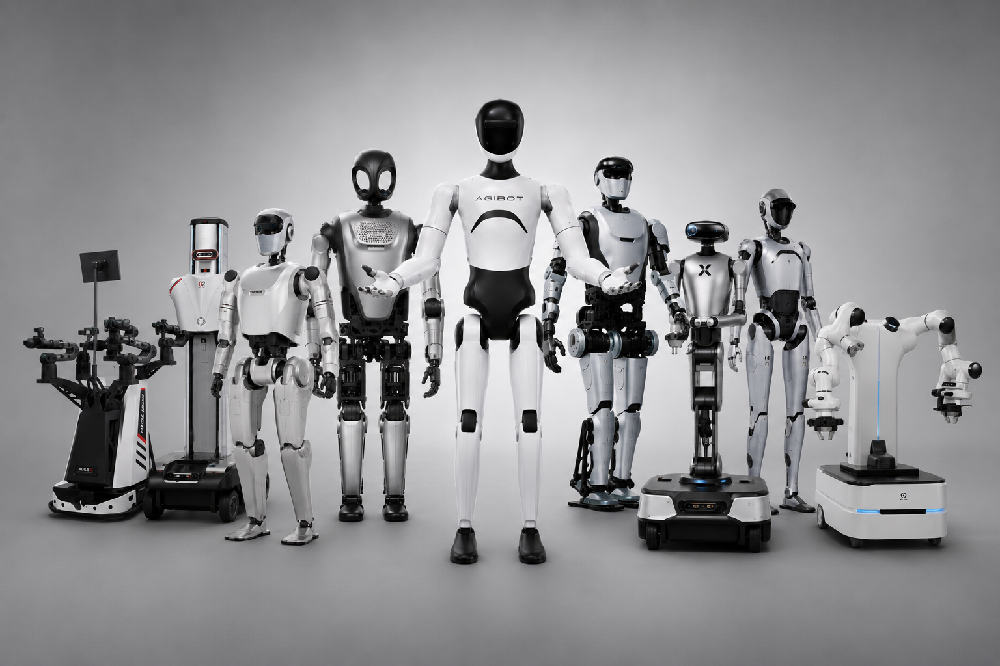

<h1 align="center">🤖 Embodied API in the Wild</h1>

  <em>看看各路研究者的 zero-shot 复现，理解模型在真实机器人上能做什么</em>

  <strong>It’s amazing what you can learn if you’re not afraid to try.</strong>

  <em>—— Robert A. Heinlein, Have Space Suit–Will Travel</em>

---

## 写在前面

模型在真实机器人上到底表现如何？我把一些公开的 zero-shot 复现放在一起，从实际任务和视频里看看各大 api zero-shot 的能力（目前包括 astra、dream1、破壳 api）。

整个项目分为了两个部分去整理：

1. **Benchmark**，看不同模型在同一套任务中的表现；
2. 不同模型 zero-shot 能力表现，分析**理解能力、抓取能力、精细操作能力和长程任务能力**，并总结对于这些 api 泛化能力的感受；

这些初步结论综合 **实验结果、视频表现和研究者的使用反馈**。每条案例保留研究者、实验条件、具体结果和原始来源，方便核对与更新。

如果你也对具身智能的 zero-shot 复现感兴趣，欢迎与我交流、分享实验和观察，一起共建这个项目！： 📧：[yirongzzz@163.com](mailto:yirongzzz@163.com)

## 📋 目录

| 章节 | 内容 |
| --- | --- |
| [📊 Benchmark](#-benchmark) | 多模型对比、任务设置与评测结果 |
| [🤖 Dream-1](#-dream-1) | [理解能力](#-理解能力) · [抓取能力](#-抓取能力) · [精细操作能力](#-精细操作能力) · [长程任务能力](#-长程任务能力) |
| [🤖 GPT-6 Astra](#-gpt-6-astra) | [理解能力](#-理解能力-1) · [抓取能力](#-抓取能力-1) · [精细操作能力](#-精细操作能力-1) · [长程任务能力](#-长程任务能力-1) |
| [🤖 破壳 RoboAPI](#-破壳-roboapipoke-aurora) | [理解能力](#-理解能力-2) · [抓取能力](#-抓取能力-2) · [精细操作能力](#-精细操作能力-2) · [长程任务能力](#-长程任务能力-2) |
| [🤖 Gemini](#-gemini) | [理解能力](#-理解能力-3) · [抓取能力](#-抓取能力-3) · [精细操作能力](#-精细操作能力-3) · [长程任务能力](#-长程任务能力-3) |

## 📊 Benchmark

先看同一套任务里不同模型的表现。这里整理多模型评测与同台测试，关注 zero-shot 复现，也保留有示范或微调的对照。每项评测的训练条件与计分方式分别记录。

**任务难度（满分 3🌟）**：按公开任务设置作个人判断。🌟 以基础抓放或简单姿态调整为主；🌟🌟 加入目标筛选、空间对齐或连续步骤；🌟🌟🌟 涉及高精度接触、柔性物体、复杂双臂协作或多重任务约束。星级描述任务要求，模型表现另看评测结果。

**评测来源**：包含了官方与第三方的评测，个人认为以第三方的评测效果为主。

### 一、RoboCurve · RoboDojo-RC Tier 1

**RoboCurve · 2026-10-19**　[▶ 视频 / 记录](https://robocurve.org/all-runs/?benchmark=robodojo-rc-tier-1)

**任务介绍：** 双臂 I2RT YAM 上的六类桌面操作，从分类、摆放到双臂对齐与连续搬运。每项按中间步骤计分，完整完成还要满足最终状态。[任务指令与评分规则](https://robocurve.org/opus-5-5-robodojo-rc-tier-1/)

| 任务 | 要完成什么 / 难点 | 难度 |
| --- | --- | --- |
| 堆碗 | 将三个碗叠稳，连续放置时保持对齐。 | 🌟🌟 |
| 物体分类 | 把两类物体分别放进两个篮子，不能混放或遗漏。 | 🌟🌟 |
| 竖起瓶子 | 将三个瓶子全部竖直放稳，需要反复调整抓取与放置姿态。 | 🌟🌟 |
| 收纳并关箱 | 把三个物体放入保险箱，再把盖子关上。 | 🌟🌟 |
| 套笔帽 | 两臂分别拿住笔和笔帽，对齐后套牢。 | 🌟🌟🌟 |
| 装水果再倾倒 | 把三件水果装入小碗，再全部倒进大碗，保持物体与容器受控。 | 🌟🌟🌟 |

**对比模型：** Dream-1 / GPT-6 Astra / Gemini

**官方对比图**

  <a href="assets/robocurve-task-progress.jpg">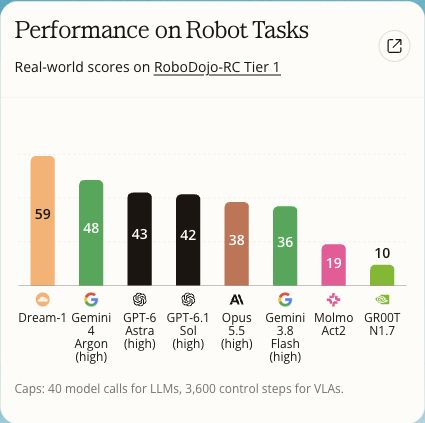</a>

来源：[RoboCurve 官方主页](https://robocurve.org/)，2026-11-04 页面快照。图中为**平均任务进度分**，数值取整；包含更多模型配置。LLM 最多 40 次模型调用，VLA 最多 3,600 个控制步。

| 模型 | 来源报告或展示的结果 |
| --- | --- |
| Dream-1 | 59.3% 平均任务进度得分；完整完成约 31/120（[公开日志的二次统计](https://aiwiki.ai/wiki/dream_1)，非官方成功率） |
| GPT-6 Astra | 最高列出的 high/fast 配置平均分 42.5% |
| Gemini | Gemini 4 Argon high/priority 配置平均分 48.2% |

### 二、OpenRUA · 19 类真机任务

**OpenRUA Team · 2026-11-03**　[📄 报告](https://openrua.ai/uni-robot-agent)

**任务介绍：** 在真实双臂机器人上设置 19 项任务，覆盖空间理解、物体泛化、指令遵循、组合泛化与未见任务。下面选取六个代表任务，完整列表见[原文 §3.2 / Table 3](https://openrua.ai/uni-robot-agent)。

| 代表任务 | 要完成什么 / 难点 | 难度 |
| --- | --- | --- |
| 水果抓放 | 识别目标水果并完成抓取、放置。 | 🌟 |
| 按颜色叠杯 | 按要求的颜色顺序叠杯，同时保持堆叠稳定。 | 🌟🌟 |
| 折抹布 | 操作柔性物体，控制布料变形并完成折叠。 | 🌟🌟🌟 |
| 试管入架 | 将试管对准架孔并插入，位置和姿态都需要准确。 | 🌟🌟🌟 |
| 双臂交接瓶子 | 两臂协调接管物体，交接时保持稳定抓持。 | 🌟🌟🌟 |
| 汉诺塔 | 按任务约束移动圆盘并组成三层塔，需要规划与状态跟踪。 | 🌟🌟🌟 |

**对比模型：** Dream-1 / GPT-6 Astra / Qwen / π0.5

**能力分项对比**

  <a href="assets/openrua-real-eval-table.jpg">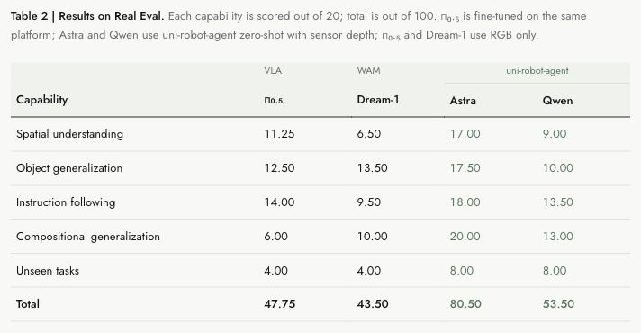</a>

来源：[OpenRUA · Table 2](https://openrua.ai/uni-robot-agent#real-eval-summary)，原网页表格截图。**每个能力维度满分 20，总分 100**；π₀.₅ 经微调，Astra / Qwen 使用深度信息，Dream-1 / π₀.₅ 仅用 RGB。

<table>
  <tr><th align="left">📝 备注</th></tr>
  <tr><td>在这个 benchmark 下，astra 和 qwen 并非端到端的输出，采用的是 Agent 形式</td></tr>
</table>

### 三、破壳 · RoboAPI 官方任务评测

**PokeBot · 2026-10-30**　[📄 报告 / ▶ 任务视频](https://pokebot.com/ai)

**任务介绍：** 官方自建评测覆盖转移整理、姿态形状对齐、环境交互三类操作。页面称任务框架包含近 1,000 个物体实例、近 10,000 条不同指令；这两个数字不能直接当作每个模型的测试次数。

| 代表任务 | 要完成什么 / 难点 | 难度 |
| --- | --- | --- |
| 衣物分类入篮 | 按指令选对衣物和容器，完成抓放。 | 🌟🌟 |
| 翻包装露出条码 | 调整物体朝向，使指定一面可见。 | 🌟🌟 |
| T 形块对齐目标 | 同时对准位置和朝向。 | 🌟🌟🌟 |
| 毛巾对折 | 抓住合适位置，控制布料变形。 | 🌟🌟🌟 |
| 开关抽屉 | 抓住把手，并沿抽屉运动方向施力。 | 🌟🌟 |
| 擦除指定图形 | 选对区域，维持工具接触并检查擦除结果。 | 🌟🌟 |

**对比模型：** Poke-Aurora（RoboAPI） / GPT-6 Astra / π₀.₅ / MolmoAct2

  <a href="assets/pokebot-benchmark.jpg">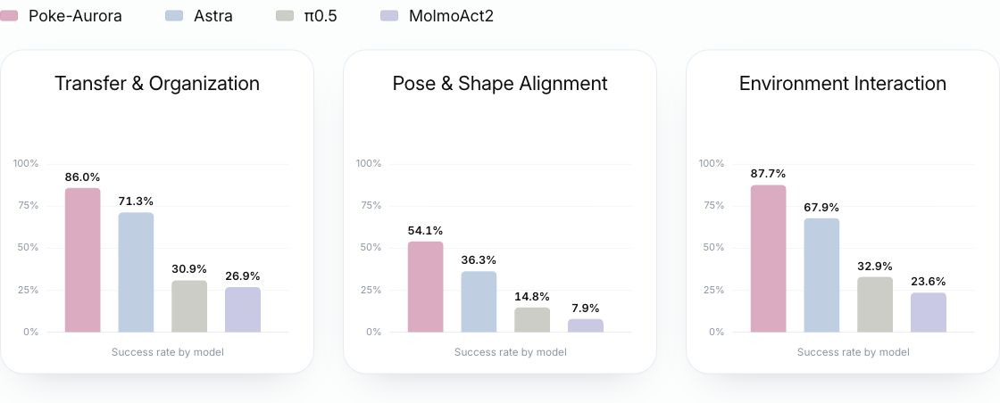</a>

来源：[破壳官方发布页](https://pokebot.com/ai)，2026-11-04 页面快照。三组 Poke-Aurora / Astra 成功率依次为 86.0% / 71.3%、54.1% / 36.3%、87.7% / 67.9%；图中另含 π₀.₅ 与 MolmoAct2。

<table>
  <tr><th align="left">📝 小结</th></tr>
  <tr><td><strong>我的理解：</strong>这组结果可以帮助选择值得优先复现的任务，但还不足以判断换一个实验室后能否保持相同优势。要验证泛化，需要结合下方外部案例，并在一致条件下重复测试。  <strong>Zero-shot 条件：</strong>官方将 RoboAPI 定位为无需针对新任务额外采集数据或训练的接口；本组各模型的微调、示范、重复次数与预算未完整披露。图中是官方报告的分类成功率，暂不作为独立复现的统一排名。</td></tr>
</table>

### 四、XDOF · Ember-0

**XDOF · 2026-10-23 原报告**　[▶ 视频 / 记录](https://benchmarks.xdof.ai/)

**任务介绍：** Ember-0 在双臂 YAM 上设置 16 类操作任务，同时考察空间推理、工具使用、精细接触和连续执行。下面列出代表任务；每项记录中间步骤与最终是否成功。[官方任务说明](https://www.xdof.ai/blog/evaluating-llms)

| 代表任务 | 要完成什么 / 难点 | 难度 |
| --- | --- | --- |
| 竖起倒瓶 | 调整倒放瓶子的姿态，让它竖直放稳。 | 🌟 |
| 拉毛巾取玩具 | 先拉近毛巾，再拿到原本够不着的玩具，需要判断间接作用。 | 🌟🌟 |
| 用夹钳夹面包 | 正确抓持并操纵夹钳，让工具夹住面包。 | 🌟🌟🌟 |
| 不碰球让球入碗 | 倾斜托盘使球滚进碗，控制方向与运动过程。 | 🌟🌟🌟 |
| 展开 T 恤 | 双臂控制衣角，处理布料不断变化的形状。 | 🌟🌟🌟 |
| 托盘上准备麦片餐 | 连续完成盛放与摆放步骤，跟踪进度并协调双臂。 | 🌟🌟🌟 |

**对比模型：** GPT-6 Astra / GPT-6.1 Sol / Fable 5.1 / Opus 5.5 / Meta Muse

**整体成功率对比**

  <a href="assets/xdof-results.png">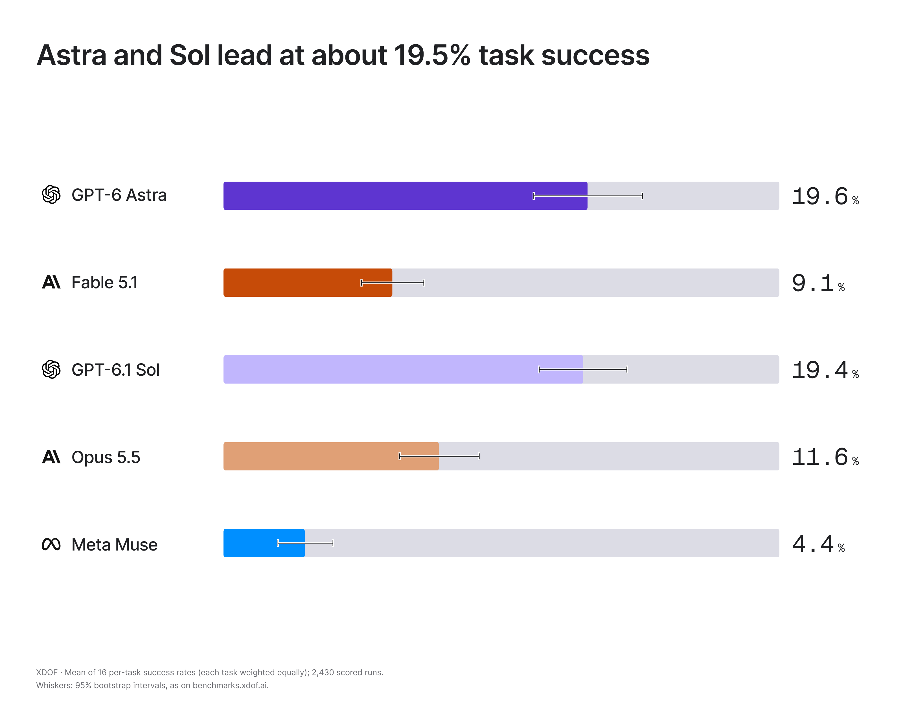</a>

来源：[XDOF 原报告](https://www.xdof.ai/blog/evaluating-llms) · [原图](https://www.xdof.ai/blog/evaluating-llms/results.png)。采用 **16 项任务成功率的等权平均**，误差线为 95% bootstrap 区间；这组对比不含 Gemini 和 Dream-1。

<strong>展开：16 项任务的逐模型成功率</strong>

  <a href="assets/xdof-task-success.png">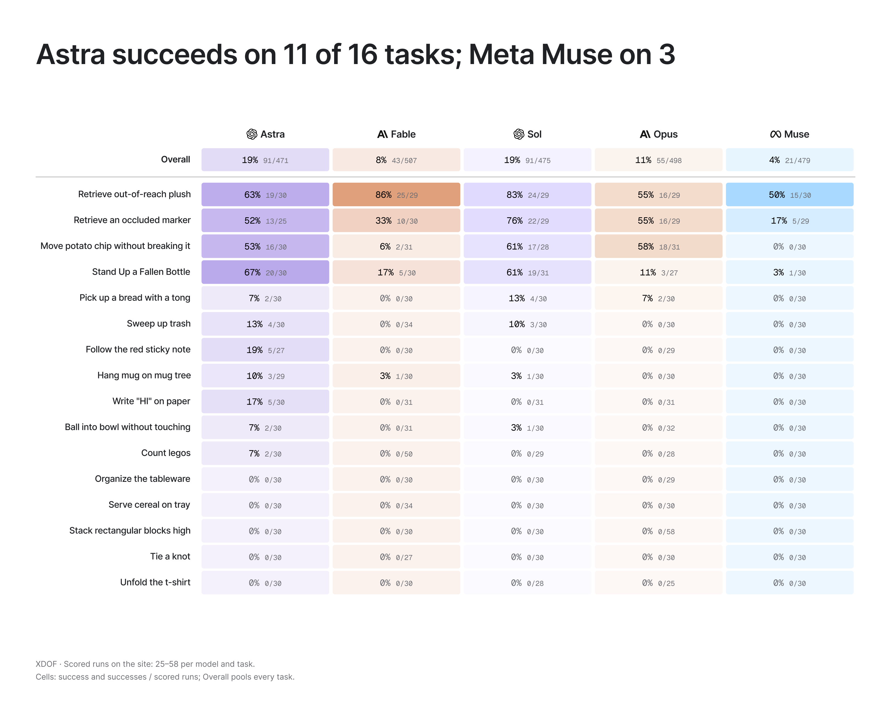</a>

[逐任务原图](https://www.xdof.ai/blog/evaluating-llms/task-success.png)。每格同时给出成功率与成功次数 / 有效运行次数；`Overall` 行合并全部运行计算，与上图按任务等权平均的口径不同。

<table>
  <tr><th align="left">📝 阅读备注</th></tr>
  <tr><td><strong>任务设置：</strong>16 类真机任务；逐任务成功率与运行预览  <strong>阅读备注：</strong>图表采用原报告的五模型结果；逐任务完成率便于对照上面的任务难度。Dream-1 的早期预览测试另列，未参与本组排名。  <strong>Zero-shot 条件：</strong>原报告称 zero-shot task reasoning：模型依据任务描述推理，控制栈提供相机、本体说明、历史与工具；不据此推断闭源预训练数据完全未见这些任务。</td></tr>
</table>

### 五、Cortex · 微波炉与移液器

**Cortex AI Research · 2026-09-17**　[▶ 视频 / 记录](https://cortexrobot.ai/research/llm-real-world-robotics-evals/)

**任务介绍：** 在同一双臂 YAM BOX 上完成两项任务：把三明治送入微波炉并关门，以及给移液器装上 5 mm 吸头。每次最长 10 分钟，完成中间步骤也可得分。[原始任务与演示](https://cortexrobot.ai/research/llm-real-world-robotics-evals/)

| 任务 | 要完成什么 / 难点 | 难度 |
| --- | --- | --- |
| 三明治放进微波炉并关门 | 放入食物，处理突出门口的托盘，再关好门并检查，涉及步骤衔接与接触控制。 | 🌟🌟 |
| 安装 5 mm 移液器吸头 | 对准小吸头并装牢；还需要识别未装上的情况，重新对齐尝试。 | 🌟🌟🌟 |

**对比模型：** GPT-6 Astra / Gemini 3.8 Flash / Fable 5.1

**两项任务得分对比**

  <a href="assets/cortex-microwave-scores.png">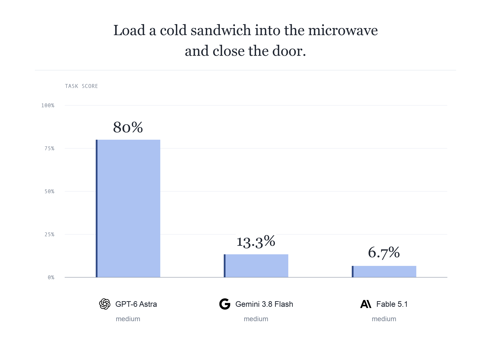</a>
  <a href="assets/cortex-pipette-scores.png">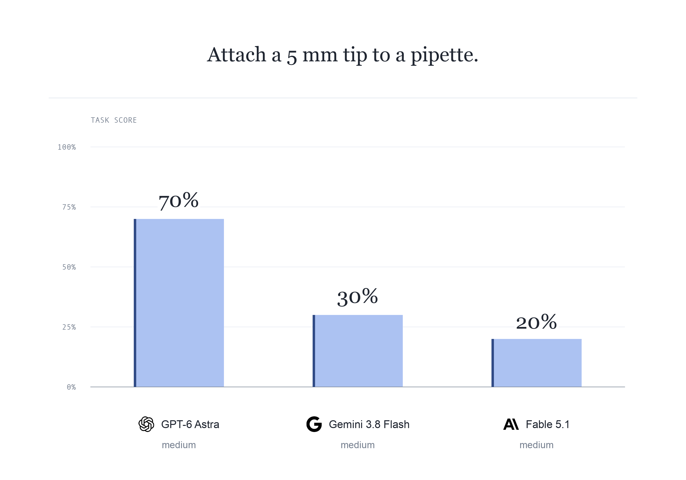</a>

来源：[Cortex 原报告](https://cortexrobot.ai/research/llm-real-world-robotics-evals/)（2026-09-17）。左图为微波炉任务，右图为移液器任务，点击可看大图。三模型均使用 medium reasoning；**任务得分包含中间步骤，不等于完整成功率**。

<table>
  <tr><th align="left">📝 小结</th></tr>
  <tr><td><strong>任务设置：</strong>同一 YAM BOX 平台，顶视与双腕相机；两项操作任务，每次最长 10 分钟  <strong>阅读备注：</strong>各模型均使用深度图像，按中间步骤评分。任务 zero-shot 条件未披露，进度得分不能当作完整任务成功率。  <strong>Zero-shot 条件：</strong>现有收录资料未明确披露任务训练、微调或示范条件，暂不认定为已报告的 zero-shot。</td></tr>
</table>

### 六、四模型抓南瓜

**Ali / Archie / Noah · 2026-11-02**　[▶ 视频 / 记录](https://x.com/robot_xyz_rpy/status/2117314589507350695)

**任务介绍：** 用 YAM 夹爪抓起南瓜并放进盒子。测试者说明，该夹爪只能通过南瓜柄端可靠提起物体，因此需要先找到可抓位置，再完成夹持、搬运和放置。[测试者原帖](https://x.com/robot_xyz_rpy/status/2117314589507350695)

| 任务 | 要完成什么 / 难点 | 难度 |
| --- | --- | --- |
| 抓南瓜入盒 | 选择柄端而非主体，准确闭合夹爪；抓空后判断是否需要换位置。 | 🌟🌟 |

**对比模型：** Dream-1 / GPT-6 Astra / RoboAPI / Gemini

| 模型 | 来源报告或展示的结果 |
| --- | --- |
| Dream-1 | 先尝试抓主体，随后改抓柄部并完成放置 |
| GPT-6 Astra | 尝试对准柄部，但夹爪闭合位置过高 |
| RoboAPI | 多次尝试主体或顶部，未完成有效提起 |
| Gemini | 接近柄部，但未稳定夹住 |

<a href="https://x.com/robot_xyz_rpy/status/2117314589507350695">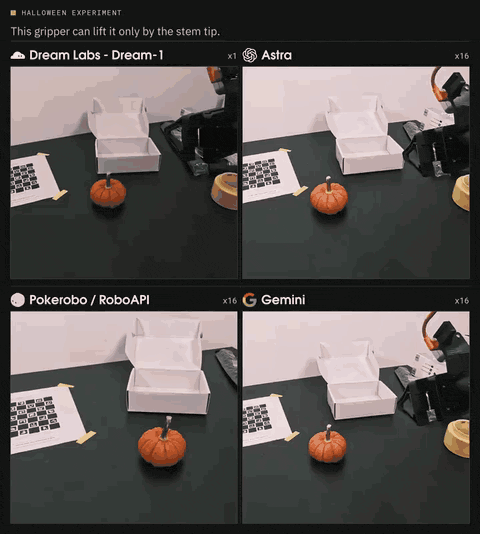</a>

四模型同台片段 · 原片全段约 46 秒，GIF 相对原片 2×。原片中 Dream-1 为 1×，其余为 16×，不可据此比较执行速度。

---

<table>
  <tr><th align="left">📝 备注</th></tr>
  <tr><td>对于不同模型的能力分析，以第三方测试为主，官方展示的能力不认为具备有对对应的能力</td></tr>
</table>

## 🤖 Dream-1

Dream-1 的公开复现支持一个初步判断：基础抓放已经有跨本体的能力，但指令约束、精确接触和完整任务执行仍有明显缺口。

### 🧠 理解能力

<table>
  <tr><th align="left">能力小结</th></tr>
  <tr><td>❌ <strong>对于环境的感知理解能力较弱，对于物体的类别泛化能力较弱，但有成功案例</strong>  Eastworld 的 <a href="https://dreamlabs.ai/research/dream-1/assets/beta/eastworld.mp4">zero-shot 苹果入盒</a>提供了成功例子；SE3 的错箱、违反禁抓约束和 Blupe 的选错目标说明，复杂约束遵循仍有明确失败。</td></tr>
</table>

- **[SE3：目标选择与指令约束](https://se3labs.ai/blog/dream-eval-1/#instructions)** · ▶ [不用尺子，直接拿起积木](https://se3labs.ai/blog/dream-eval-1/clips/cube_lift.mp4) · [物体放错箱](https://se3labs.ai/blog/dream-eval-1/clips/wrong_bins.mp4)

  SE3 Labs · 2026-10-30 · 双臂真机工作站

  要求用尺子推齐、不得拿起积木时，记录中出现直接抓起积木；分类任务也有把物体搬到错误箱子的情况。[任务与评分规则](https://docs.se3labs.ai/tasks/robodojo-real/)

  <a href="https://se3labs.ai/blog/dream-eval-1/clips/cube_lift.mp4">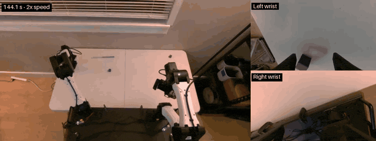</a>

  违反“不得拿起积木”的约束 · 原片全段，已标 2×，GIF 未另加速。

  

  
展开更多示例（1 段 GIF）

  <a href="https://se3labs.ai/blog/dream-eval-1/clips/wrong_bins.mp4">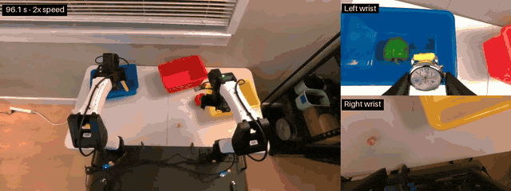</a>
  
  SE3 分类任务将物体放进错误箱子 · 原片全段，已标 2×，GIF 未另加速；不代表完整任务成功。
  
  

  
- **[Blupe 社区试用：要苹果，却抓红积木](https://www.reddit.com/r/robotics/comments/1xaz5ve/dream_labs_dropped_a_monster/)** · ▶ 视频帖

  u/Lumpy_Week7304 · 2026-10

  帖子记录了要求移动苹果、实际开始抓红积木且持续动作的情况。未披露尝试次数；附有 [Blupe Playground](https://playground.blupe.io/) 体验入口。

- **[XDOF：红色便签的指令推理](https://x.com/xdofai/status/2112252852257353761)** · 📄 [具体评价](https://x.com/xdofai/status/2112252855222673530)

  XDOF · 2026-10-19 · 真机双臂评测平台 · 早期预览版，任务训练条件未披露

  早期报告将“遵循红色便签”列为推理表现不足的任务示例，但没有在这条记录中给出逐次结果；同批操作表现见下方精细操作能力。

### 🦾 抓取能力

<table>
  <tr><th align="left">能力小结</th></tr>
  <tr><td>✅ <strong>已有基础抓放的真机 zero-shot 演示。</strong>  小林的自制机械臂抓塑料瓶、毛绒玩具，以及 Eastworld 的苹果入盒，支持基础抓取能力。SO-101 的反复失败表明，这项能力尚不能在所有配置上稳定复现。</td></tr>
</table>

- **自制机械臂：▶ [塑料瓶](https://x.com/CH1H160/status/2114285244325265494) · [毛绒玩具](https://x.com/CH1H160/status/2114344652036096491)**

  小林竜太（Ryota Kobayashi） · 2026-10-25 · 个人自制机器人 · 作者明确称 zero-shot

  同一自制机器人分别展示塑料瓶与毛绒玩具抓取。原帖明确称 zero-shot，但没有给出成功率或完整调试耗时。

  <a href="https://x.com/CH1H160/status/2114285244325265494">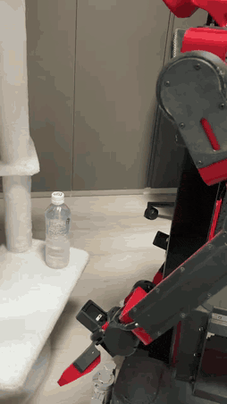</a>

  塑料瓶抓持 · 原片全段，保持原片播放速度；作者自述 zero-shot，不据此推断完整搬运放置。

  

  
展开更多示例（1 段 GIF）

  <a href="https://x.com/CH1H160/status/2114344652036096491">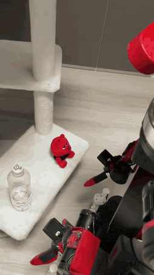</a>

  毛绒玩具夹持 · 原片全段，保持原片播放速度；与塑料瓶为同一本体，作者自述 zero-shot。

  

- **[Maker Arm Station 抓青柠](https://x.com/Ryan_Resolution/status/2115320267438506302)** · ▶ 视频

  Ryan Chan / MakerMods · 2026-10 · Maker Arm Station · 合作方演示，作者自述 zero-shot；完整训练与重复统计未披露

  视频展示青柠抓放。另有 [Caldera 部署记录](https://x.com/Ryan_Resolution/status/2113836401821368566) 报告 Metal Arm Station 约 10 分钟部署后可开始 zero-shot 尝试；两条记录的平台不同，接入用时不能解释为青柠任务成功率。

  <a href="https://x.com/Ryan_Resolution/status/2115320267438506302">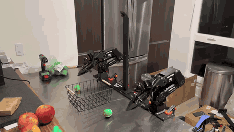</a>

  抓青柠入篮 · 原片全段，保持原片播放速度；作者自述 zero-shot，未公布重复成功率。

- **[Eastworlds：陌生实验室中的抓放](https://x.com/eastworlds_io/status/2114613622047486011)** · ▶ [苹果入盒原视频（官方收录）](https://dreamlabs.ai/research/dream-1/assets/beta/eastworld.mp4)

  Eastworlds · 2026-10-26 · 马来西亚实验室双臂平台 · Beta 合作方自述 zero-shot

  官方收录片段展示苹果入盒；部署帖说明环境由 Eastworlds 独立配置，Dream Labs 未参与。另有 [实验室 Playground](https://eastworlds.io/playground) 入口，未公布重复次数。

  <a href="https://dreamlabs.ai/research/dream-1/assets/beta/eastworld.mp4">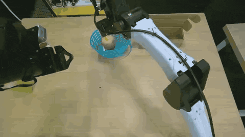</a>

  苹果抓起并入盒 · 原片全段，保持原片播放速度；合作方自述 zero-shot。

- **[Mecka：从架子抓起试管](https://dreamlabs.ai/research/dream-1/assets/beta/mecka.mp4)** · ▶ 原视频

  Mecka · 2026-10 · 合作方平台 · 官方收录的外部演示，逐任务训练条件未披露

  片段展示从架子中拿起试管，可以观察细长物体抓取；未展示插入或装配，也未提供重复统计。

  <a href="https://dreamlabs.ai/research/dream-1/assets/beta/mecka.mp4">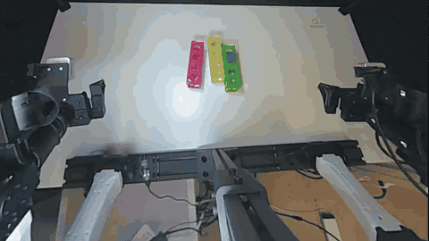</a>

  从架子抓起试管 · 原片全段约 36 秒，GIF 相对原片 2×；未展示试管插入，逐任务训练条件未披露。

- **[南瓜：改抓柄部后完成放置](https://x.com/robot_xyz_rpy/status/2117314589507350695)** · ▶ 视频

  Ali / Archie / Noah · 2026-11-02 · I2RT YAM · 同台对比，zero-shot 条件未披露

  展示中先尝试抓主体，失败后改抓柄部并完成放置；[同场记录](https://x.com/archiexzzz/status/2117316273281564827) 补充了这次测试背景。未给出统一起始状态与重试预算下的重复结果。

  <a href="https://x.com/robot_xyz_rpy/status/2117314589507350695">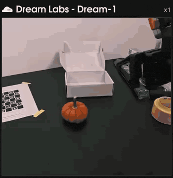</a>

  Dream-1 左上画面裁切 · 原片全段约 46 秒，原标 1×，GIF 相对原片 2×；最终完成放置。

- **[SO-101 抓除臭剂瓶](https://x.com/praneethsamine/status/2113107614796046572)** · ▶ 视频

  Praneeth Samineni · 2026-10-22 · SO-101 单臂 · 明确无微调，20 多次尝试仍未完整抓放

  实验调整了左右臂映射、指尖 TCP 与相机，仍未完整完成抓放。单臂与默认双臂配置的差异尚未通过对照实验隔离。

  <a href="https://x.com/praneethsamine/status/2113107614796046572">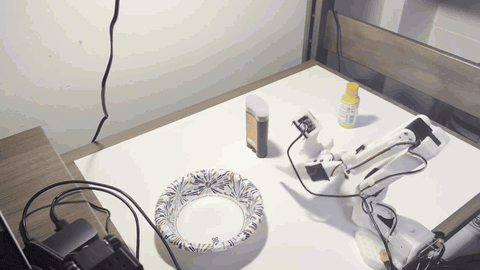</a>

  SO-101 抓取失败 · 原片全段，保持原片播放速度；未完成完整抓放。

- **[移动底盘 SO-101 抓积木](https://x.com/BharatJain/status/2114104114791715084)** · ▶ 视频

  Bharat Jain · 2026-10-24 · SO-101 + 移动底盘 · zero-shot 尝试，视频中相机支架损坏

  真机记录未可靠完成积木抓放，并发生相机支架损坏；平台采用单臂、腕相机与移动底盘。此前报告的 [3/5 结果](https://x.com/BharatJain/status/2112588516874236268) 来自 Playground，不能与真机结果合并。

  <a href="https://x.com/BharatJain/status/2114104114791715084">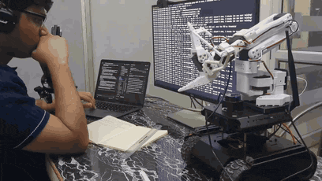</a>

  移动 SO-101 失败与片末故障 · 摘取原片 00:30–00:53.35，保持原片播放速度。

### 🪡 精细操作能力

<table>
  <tr><th align="left">能力小结</th></tr>
  <tr><td>❌ <strong>尚未确认真机 zero-shot 精细操作成功。</strong>  SE3 的试管任务虽有 9/10 次抬起，但指定插入未完成；官方插吸管、折盒子和移液器片段未逐项披露训练条件，暂不能据此确认 zero-shot 精细操作。</td></tr>
</table>

- **[SE3：试管插入与套柱](https://se3labs.ai/blog/dream-eval-1/#episodes)** · ▶ [试管任务录像](https://data.se3labs.ai/samples_v1/blog_post/dream-eval-1/episodes/ROBODOJO-REAL-21__20261026-013342__ep_0002/preview.mp4)

  SE3 Labs · 2026-10-30 · 双臂真机工作站 · 第三方 zero-shot 评测，试管任务共 10 次

  SE3 的逐次评分记录显示，**9/10 次抬起至少一根试管，0/10 次让管尖进入指定孔**。下方是第 3 次试管任务：要求将两根试管依次插入 1、3 号孔；其中一根被抬到架子上方，随后倒在架子上，另一根未抬起。能抓起试管，但尚未完成对准与插入。

  <a href="https://data.se3labs.ai/samples_v1/blog_post/dream-eval-1/episodes/ROBODOJO-REAL-21__20261026-013342__ep_0002/preview.mp4">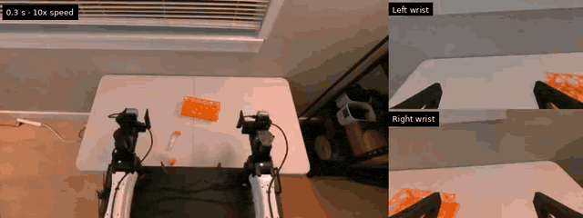</a>

  试管抬起后倒在架上 · 第 3 次试管任务的完整预览，原片已标 10×，GIF 未另加速；点击查看原视频。

  

  
展开套柱任务示例（2 段 GIF）

  套柱任务同样未完成正确插入。以下分别是套柱板靠近中央与位于边缘时的片段，与上方试管任务分开记录。

  <a href="https://se3labs.ai/blog/dream-eval-1/clips/central_peg.mp4">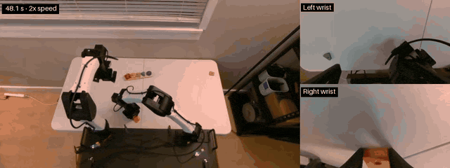</a>

  套柱板靠近中央 · 原片全段，已标 2×，GIF 未另加速。

  <a href="https://se3labs.ai/blog/dream-eval-1/clips/far_right_peg.mp4">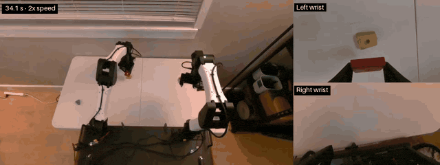</a>

  套柱板位于边缘 · 原片全段，已标 2×，GIF 未另加速。

  

- **[插吸管、折衣服与擦拭](https://dreamlabs.ai/research/dream-1/)** · ▶ **官方**内部任务合集

  Dream Labs · 2026-10 · I2RT YAM 等内部机器人 · 官方精选，逐片段训练条件未完整披露

  合集展示插吸管、折衣服和擦拭等插入、柔性物体与接触操作；

  <a href="https://dreamlabs.ai/research/dream-1/assets/demo/8.mp4">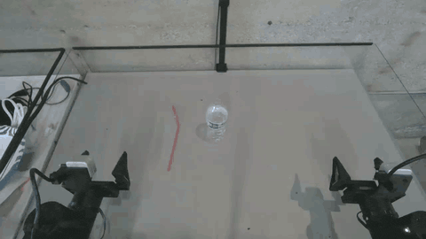</a>

  插吸管 · 原片全段，保持原片播放速度；官方精选，逐片段训练条件未完整披露。

  

  
展开更多示例（2 段 GIF）

  <a href="https://dreamlabs.ai/research/dream-1/assets/demo/7.mp4">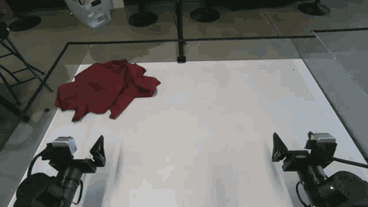</a>

  折衣服 · 原片全段，GIF 相对原片 2×；官方精选，逐片段训练条件未完整披露。

  <a href="https://dreamlabs.ai/research/dream-1/assets/demo/9.mp4">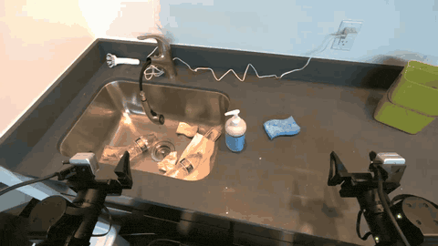</a>

  海绵擦拭 · 原片全段，保持原片播放速度；官方精选，逐片段训练条件未完整披露。

  

- **[合作方：折盒子与移液器](https://dreamlabs.ai/research/dream-1/)** · ▶ [KAIST 折盒子](https://dreamlabs.ai/research/dream-1/assets/beta/kaist.mp4) · [Cortex 移液器](https://dreamlabs.ai/research/dream-1/assets/beta/cortex.mp4)

  KAIST / Cortex · 2026-10 · 外部双臂平台 · 官方收录的合作方演示

  分别展示折盒子与移液器操作。页面提供任务片段和部分 rollout 标注，尚不足以统计这些操作的可重复性。

  <a href="https://dreamlabs.ai/research/dream-1/assets/beta/kaist.mp4">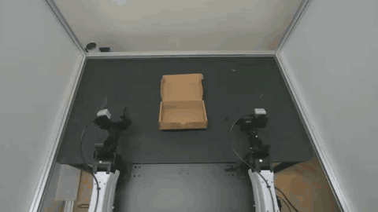</a>

  KAIST 折盒演示 · 原片全段，保持原片播放速度；逐任务训练条件未披露。

  

### 🧩 长程任务能力

<table>
  <tr><th align="left">能力小结</th></tr>
  <tr><td>✅ <strong>组合系统下已有 zero-shot 多步骤任务演示。</strong>  Dexmate 已展示导航到货架、拿取番茄酱并丢弃的流程。Dream-1 负责操作，规划与导航由外部模块承担；这条记录支持组合系统执行，不证明 Dream-1 能独立规划长任务。</td></tr>
</table>

- **[SE3：分类后取回放错的笔](https://se3labs.ai/blog/dream-eval-1/#skills)** · ▶ [纠错视频](https://se3labs.ai/blog/dream-eval-1/clips/sorting_recovery.mp4) · [装箱视频](https://se3labs.ai/blog/dream-eval-1/clips/packing.mp4)

  SE3 Labs · 2026-10-30 · 双臂真机工作站 · 10 类任务、100 次 zero-shot，每次最多 180 秒

  分类片段中先把白笔放进汽车所在箱，随后取回并放到黑笔所在箱，仍有物品未整理。本轮完整完成 **0/100**，平均里程碑分 **8/100**，57 次至少达到一个里程碑。

  <a href="https://se3labs.ai/blog/dream-eval-1/clips/sorting_recovery.mp4">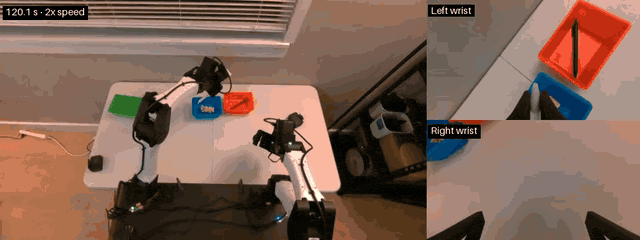</a>

  取回放错箱的白笔 · 原片全段，已标 2×；局部纠错不代表整项任务完成。

  

  
展开更多示例（1 段 GIF）

  <a href="https://se3labs.ai/blog/dream-eval-1/clips/packing.mp4">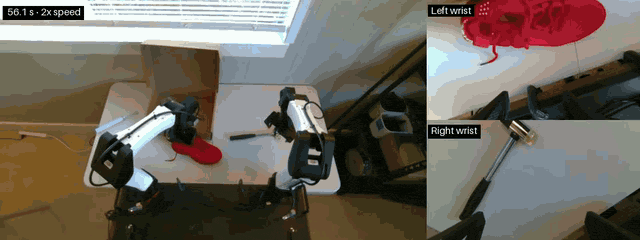</a>

  SE3 装箱任务的局部动作与失败片段 · 原片全段，已标 2×，GIF 未另加速；不代表完整任务成功。

  

- **[RoboCurve：逐次运行与任务进度](https://robocurve.org/all-runs/?benchmark=robodojo-rc-tier-1)** · ▶ 运行合集

  RoboCurve · 2026-10 · I2RT YAM · 独立评测，任务训练条件未披露

  平均任务进度分为 59.3%，完整完成需结合逐次最终状态查看。YAM 属于 Dream-1 的训练本体，该结果不检验陌生本体 zero-shot。

  本轮补入叠碗 trial 4：`dream_native_abe8b92c6997`，[记录](https://robocurve.org/all-runs/records.2a44f77b200f/robodojo-omen_rig-2_dream_native_abe8b92c6997.json)与[日志](https://runs.robocurve.org/dream-1-2026-10-18/logs/omen_rig-2_dream_native_abe8b92c6997.html)标记 complete，约 43 秒达到最终分数。额外折叠区中的收纳关箱来自官方收录的合作方合集，与这条独立日志分别保留。

  <a href="https://runs.robocurve.org/dream-1-2026-10-18/videos/omen_rig-2_dream_native_abe8b92c6997.mp4">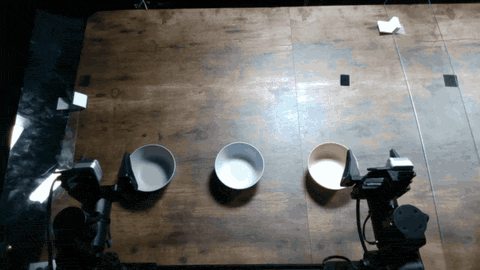</a>

  RoboCurve 叠三碗，trial 4 · 原片 00:10–00:52，中间俯视画面裁切，GIF 相对原片 2×；本次日志标记 complete，不由单次成功推算总体成功率。

  

  
展开更多示例（1 段 GIF）

  <a href="https://dreamlabs.ai/research/dream-1/assets/beta/robocurve.mp4">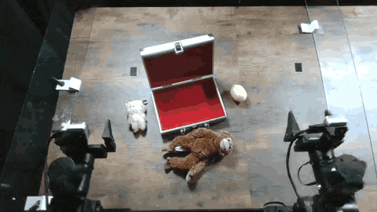</a>

  收纳并关箱 · 摘取原片 00:21.31–00:41.34，保持原片播放速度；来自 Dream Labs 收录的 RoboCurve 合作演示，不视为上述量化评测中的逐次日志。

  

- **[Metal Arm：收拾使用后的工具](https://x.com/IsaacSin12/status/2114221440522445015)** · ▶ 视频

  Isaac Sin / MakerMods · 2026-10-25 · Metal Arm · 合作方演示，任务 zero-shot 条件未披露

  视频展示使用 Dream-1 收拾工具；未报告连续运行时长、完整任务判据或重复次数，暂作为多物体收纳片段保留。

  <a href="https://x.com/IsaacSin12/status/2114221440522445015">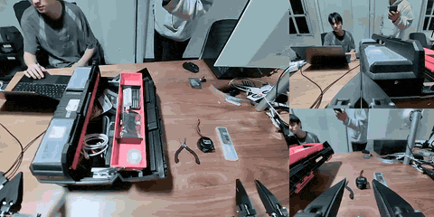</a>

  多个工具连续收纳 · 原片全段约 32 秒，GIF 相对原片 2×；任务训练条件未披露。

- **[Dexmate：从架子拿番茄酱并扔掉](https://x.com/youliangtan/status/2117683250743390315)** · ▶ [第一视角、推理记录与导航图](https://x.com/youliangtan/status/2117683252886728706)

  Youliang Tan / Dream Labs · 2026-11-03 · Dexmate · 官方组合系统；作者称未在该本体采数据或训练

  演示将 Dream-1 操作策略、MCP 高层规划与传统 ROS 导航组合，执行从架子拿番茄酱并扔掉的指令，并附第一视角和导航记录。重复次数未披露。

  <a href="https://x.com/youliangtan/status/2117683250743390315">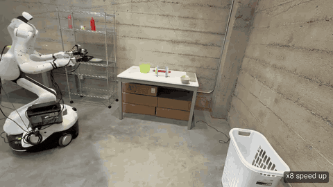</a>

  取酱、移动、丢弃 · 原片全段，已标 8×；Dream-1 操作 + 外部规划与导航。

[↑ 返回目录](#-目录)

---

## 🤖 GPT-6 Astra

把这些真机复现放在一起，我对 Astra 的理解是：它已经能依据语言目标和视觉反馈组织操作，尤其能在执行后检查状态、调整下一步。限制也很具体——认出目标之后，抓取姿态、接触精度和前后动作的衔接仍可能出错，反复修正还会带来明显的时间成本。下面的判断来自公开记录；任务示范、控制代码和传感器配置分别注明。

### 🧠 理解能力

<table>
  <tr><th align="left">能力小结</th></tr>
  <tr><td>✅ <strong>已展示 zero-shot 空间理解与主动观察。</strong>  SenseNova 的双臂插花中，Astra 移动空闲腕相机看清瓶口，再完成插入。该记录明确无任务示范，支持依据目标、空间关系和新观察调整动作。</td></tr>
</table>

- **[OpenRUA：空间理解与指令遵循](https://openrua.ai/uni-robot-agent)** · 📄 报告 · [能力分项图](#二openrua--19-类真机任务)

  OpenRUA Team · 2026-11-03 · 双臂真机 · 报告明确 zero-shot，使用深度

  在覆盖五个能力维度的任务中获得 80.50 / 100 积分。这是整套任务的得分，包含操作执行，不能单独解释为理解能力或完整任务的成功率。

- **[SenseNova：移动空闲手臂，看清瓶口再插花](https://www.sensenova.cn/has-gpt-6-astra-achieved-embodied-intelligence#real-world)** · ▶ [原视频](https://www.sensenova.cn/gpt-6/assets/video/realworld/active_vision.mp4)

  SenseNova 联合团队 · 2026-10 · 双臂 AgileX Piper · 无示范、无任务训练，提供结构化本体与工具说明

  单臂配置下，瓶口被遮挡时未完成任务；双臂配置下，Astra 移动另一只手臂上的相机，获得瓶口视角后完成插入。这里能看到观察动作与后续操作之间的衔接。

  <a href="https://www.sensenova.cn/gpt-6/assets/video/realworld/active_vision.mp4">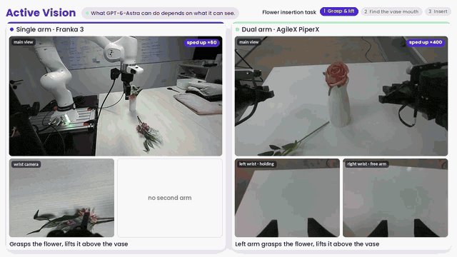</a>

  主动观察与插花 · 原片全段，原片按阶段标注不同倍速，GIF 未另加速。

- **[许华哲：抓筷子、转向与双臂交接的试用感受](https://elsewhere.news/en/crossing/10-qas-inside-the-disagreements-over-embodied-robots-convers)** · 📄 第一手访谈记录

  许华哲 / 破壳机器人 · 2026-09-14 发布 · 内部真机试用；逐项配置、zero-shot 条件未披露

  访谈记录了拿起筷子并插入杯中的成功，也提及撬动物体、叠盒和折衣的困难；双臂交接多次测试仅成功一两次。没有逐次视频与完整分母，因此作为任务间表现差异的补充记录，不计算成功率。

### 🦾 抓取能力

<table>
  <tr><th align="left">能力小结</th></tr>
  <tr><td>✅ <strong>基础 zero-shot 抓放已经完成。</strong>  GPT-GEAR 的真机基础抓放成功 5/5；同组受限芒果抓取为 0/5。可以确认基础能力，但夹爪开口、障碍与接近姿态仍会导致失败。</td></tr>
</table>

- **[GPT-GEAR：基础抓放与受限芒果抓取](https://arxiv.org/html/2610.28259v1#S7)** · ▶ [任务画廊](https://6uooon9.github.io/GPT-GEAR/#real-world)

  Youwei Zhou、Bohan Hou 等 · 2026-10-20 · ROKAE Helios 双臂 · 每任务 5 次，无示范 zero-shot

  基础抓放成功 5/5，受限芒果抓取成功 0/5。失败记录中，夹爪会沿无法容纳芒果的方向接近，或在下降时碰到旁边的桃子。画廊同时包含示范对照，单段视频的 shot 条件未逐一标注。

  <a href="https://6uooon9.github.io/GPT-GEAR/assets/videos/516c551b0dc7.mp4">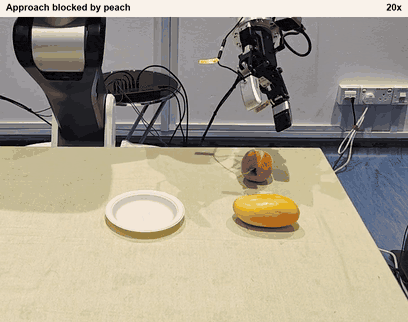</a>

  芒果抓取：接近被桃子阻挡 · 摘取原片 00:15–00:50，原标 20×，GIF 未另加速；单段 shot 条件未标注。

  

  
展开更多示例（2 段 GIF）

  <a href="https://6uooon9.github.io/GPT-GEAR/assets/videos/65e03c8d38d7.mp4">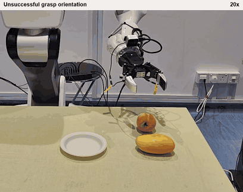</a>

  芒果抓取：抓取朝向失败 · 摘取原片 00:10–00:45，原标 20×，GIF 未另加速；单段 shot 条件未标注。

  <a href="https://6uooon9.github.io/GPT-GEAR/assets/videos/037a1c61198c.mp4">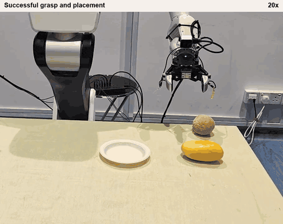</a>

  芒果抓取成功对照 · 原片全段，原标 20×，GIF 未另加速；单段 shot 条件未标注。该成功片段不计入无示范组 0/5。

  

- **[SO-101：向后探臂抓红笔](https://people.csail.mit.edu/frankzydou/blog/so101-pen-pickup/index.html)** · ▶ [原视频，50×](https://people.csail.mit.edu/frankzydou/blog/so101-pen-pickup/videos/pickup.mp4)

  Zhiyang（Frank）Dou · 2026-09-13 · LeRobot SO-101 · 未报告任务示范，复用控制与运动学代码

  红笔被放在需要机械臂向后探伸的位置，系统通过相机反馈反复调整，最终抓起并持住。端到端耗时 22 分钟；这是模型调用已有控制工具完成的一次演示，未提供重复成功率。

  <a href="https://people.csail.mit.edu/frankzydou/blog/so101-pen-pickup/videos/pickup.mp4">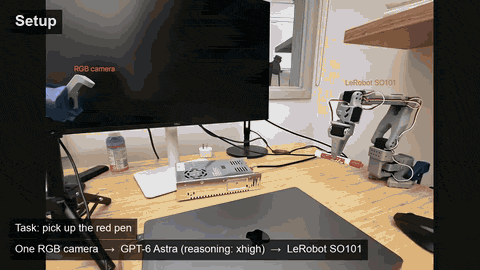</a>

  向后探臂抓红笔 · 原片全段，动作部分已标 50×，GIF 未另加速。

- **[Unitree R1-A7：开源视觉抓放](https://github.com/Ticotico410/r1a7_gpt6_control)** · ▶ [仓库演示](https://github.com/Ticotico410/r1a7_gpt6_control/blob/main/agent/docs/demo.mp4)

  Ticotico410 · Unitree R1-A7 右臂 · 工程复现；实验日期、任务训练条件未披露

  演示覆盖靠近、抓取、试抬、搬运与释放。模型给出局部目标，底层完成 IK 和执行检查；试抬后用新图确认物体跟随，释放后再确认位置。未报告重复成功率。

  <a href="https://github.com/Ticotico410/r1a7_gpt6_control/blob/main/agent/docs/demo.mp4">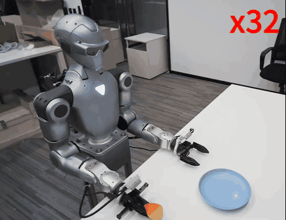</a>

  R1-A7 抓放 · 原片全段约 30 秒，仅裁切左侧真机视角，保留原标 32×，GIF 未另加速。

- **[南瓜：柄部定位与夹爪闭合](https://x.com/robot_xyz_rpy/status/2117314589507350695)** · ▶ 视频 · 失败记录

  Ali / Archie / Noah · 2026-11-02 · I2RT YAM · 同台对比；zero-shot 条件未披露

  Astra 尝试对准南瓜柄部，但夹爪闭合位置过高，没有完成抓取。视频能支持“选择的部位与实际闭合位置不一致”，尚不足以区分深度估计、标定和执行误差各自的影响。

  <a href="https://x.com/robot_xyz_rpy/status/2117314589507350695">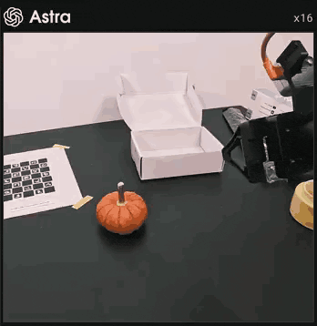</a>

  Astra 右上画面裁切 · 原片 00:00–00:31，保留原标 16×，GIF 未另加速；未完成抓取。

### 🪡 精细操作能力

<table>
  <tr><th align="left">能力小结</th></tr>
  <tr><td>✅ <strong>zero-shot 对齐插入已有成功记录。</strong>  GPT-GEAR 的方块插杯无示范组成功 2/5，已构成存在性证据；低成功率及关节限位失败说明精细执行仍不稳定。画廊单段视频的 shot 条件未逐一标注，以分组实验结果为准。</td></tr>
</table>

- **[Cortex：重新对齐 5 mm 移液器吸头](https://cortexrobot.ai/research/llm-real-world-robotics-evals/)** · ▶ [完整片段](https://cortexrobot.ai/assets/videos/llm-real-world-robotics-evals/pipette-astra-medium-success-full-episode-2min.mp4)

  Cortex AI Research · 2026-09-17 · I2RT YAM BOX · RGB + 深度；报告称开箱使用，逐项训练条件未披露

  移液器进入吸头容器后，Astra 识别出吸头尚未装好，重新对齐并尝试，最终完成安装。同组记录还展示了移动空闲手臂的腕相机来改善观察。

  <a href="https://cortexrobot.ai/assets/videos/llm-real-world-robotics-evals/pipette-astra-medium-success-full-episode-2min.mp4">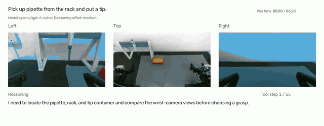</a>

  抓取、对齐与安装吸头 · 原片全段 00:00–02:00，GIF 相对原片 6×；原片本身已压缩实验时长。

- **[GPT-GEAR：方块插杯](https://arxiv.org/html/2610.28259v1#S7)** · ▶ [失败片段](https://6uooon9.github.io/GPT-GEAR/assets/videos/384d51c4c7d5.mp4)

  Youwei Zhou 等 · 2026-10-20 · ROKAE Helios · 无示范组 2/5 成功

  失败片段分别呈现边缘抓取、向内转腕触及关节限位，以及杯口未对齐。下面同时补入成功对照；画廊单段 shot 条件未单独标注，不能据此判断片段属于无示范组还是示范组。

  <a href="https://6uooon9.github.io/GPT-GEAR/assets/videos/384d51c4c7d5.mp4">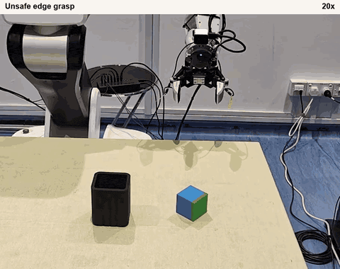</a>

  边缘抓取失败 · 原片全段，已标 20×，GIF 未另加速；单段 shot 条件未标注。

  

  
展开更多示例（3 段 GIF）

  <a href="https://6uooon9.github.io/GPT-GEAR/assets/videos/4b8f3aa76092.mp4">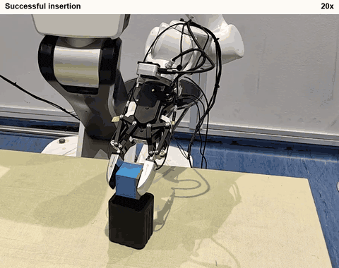</a>

  方块插杯成功示例 · 摘取原片 00:40–01:05.10，原标 20×，GIF 未另加速；单段 shot 条件未标注。

  <a href="https://6uooon9.github.io/GPT-GEAR/assets/videos/e7a47cffb597.mp4">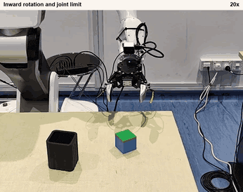</a>

  方块插杯：内旋触及关节限位 · 原片全段，原标 20×，GIF 未另加速；单段 shot 条件未标注。

  <a href="https://6uooon9.github.io/GPT-GEAR/assets/videos/c9992fe3201c.mp4">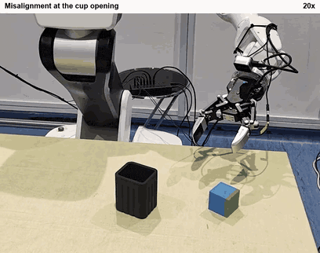</a>

  方块插杯：杯口未对齐 · 原片全段速览，原标 20×，GIF 相对原片另加速 4×；单段 shot 条件未标注，详细过程见原视频。

  

- **[RoboICL：插销、折毛巾与搭桥](https://arxiv.org/html/2609.34261v1#S4.SS3)** · 📄 真机对照 · [项目视频入口](https://mosi-ai.github.io/RoboICL-GPT6-Astra.github.io/)

  Fangcheng Liu 等 · 2026-09-28 · Franka Research 3，双 RGB 视角 · 每任务每条件 5 次

  无示范组 15 次中 11 次未获得任务进度分，平均进度分 14.45/100；部分零分轨迹仍有拾起毛巾一角等局部动作。带示范的对照改善了进度，仍有插入和搭桥未完成的记录，不能与零样本组混用。项目大量视频属于仿真，真机结果以论文该节为准。

- **[Wuji2：灵巧手从平躺到自行站立](https://people.csail.mit.edu/frankzydou/blog/wuji2-hand-stands-up/index.html)** · ▶ [真机视频](https://people.csail.mit.edu/frankzydou/blog/wuji2-hand-stands-up/videos/hand_stand.mp4)

  Zhiyang（Frank）Dou · 2026-09-17 · Wuji2 · 提供机器人模型，结合 MuJoCo 搜索与真机反馈；非无工具的一次运行

  灵巧手从平躺转为底座朝下直立，关闭电机后仍保持站立。成功片段动作约 3 分钟；[完整时间说明](https://www.linkedin.com/posts/zhiyang-frank-dou-0259111b3_gpt6-wuji2-activity-7506520636647747584-uUiG)记录了含思考与试验约 1 小时 20 分钟的项目过程，两个时长不能混用。

  <a href="https://people.csail.mit.edu/frankzydou/blog/wuji2-hand-stands-up/videos/hand_stand.mp4">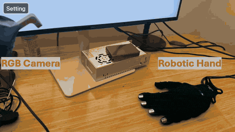</a>

  灵巧手自行站立 · 原片全段约 34 秒，保留原片 1× / 16× 的不同片段，GIF 未另加速；包含模拟搜索与真机反馈的组合系统。

- **[RoboDojo：中止的真机评测](https://arxiv.org/html/2609.24170v1#S5)** · 📄 失败诊断 · [运行记录入口](https://robodojo-benchmark.com/report/gpt-6-astra-eval)

  Wenbo Zhang 等 / RoboDojo、RoboProbe · 2026-09-21 · ARX X5 / Piper / Piper X

  测试中反复出现不合理动作并造成硬件损坏，正式真机协议因此中止。保留的 12 任务、33 条轨迹属于选择性诊断材料，不能据此计算正式成功率，也不能用仿真总榜替代未完成的真机评测。

  <a href="https://media.luminis-sim.com/media/report/gpt-6-astra/robodojo-real/arx_x5/insert_tubes/trial_2.mp4">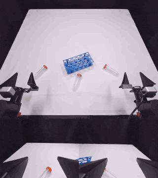</a>

  插管失败，源评分 0 · 原片全段，保持源播放速度；属于中止评测保留的诊断轨迹，不据此计算正式成功率。

  

  
展开更多示例（1 段 GIF）

  <a href="https://media.luminis-sim.com/media/report/gpt-6-astra/robodojo-real/piper/stack_bowls/trial_8.mp4">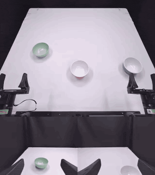</a>

  叠碗诊断示例，源评分 1 · 原片全段，保持源播放速度；属于中止评测保留的诊断轨迹，不据此计算正式成功率。

  

### 🧩 长程任务能力

<table>
  <tr><th align="left">能力小结</th></tr>
  <tr><td>✅ <strong>zero-shot 多步骤任务已有完成记录。</strong>  GPT-GEAR 的倾倒入抽屉、货架重排分别成功 2/5、1/5。可以确认有限步骤的连续执行能力，尚不能推广为长时间、复杂任务的可靠完成。</td></tr>
</table>

- **[Cortex：处理托盘，再检查微波炉门](https://cortexrobot.ai/research/llm-real-world-robotics-evals/)** · ▶ [完整片段](https://cortexrobot.ai/assets/videos/llm-real-world-robotics-evals/microwave-astra-tray-push-full-episode-2min.mp4)

  Cortex AI Research · 2026-09-17 · I2RT YAM BOX · 任务 zero-shot 条件未完整披露

  放入三明治后，Astra 用空爪将突出门口的托盘推回，再关门、退手，检查门是否保持关闭。图表按已完成的任务步骤计分，完整片段补充了最终状态与中间修正过程。

  <a href="https://cortexrobot.ai/assets/videos/llm-real-world-robotics-evals/microwave-astra-tray-push-full-episode-2min.mp4">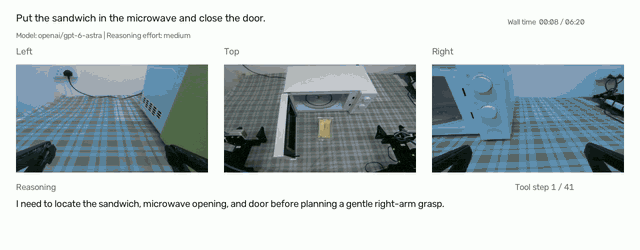</a>

  放入食物、推托盘、关门与检查 · 原片全段 00:00–02:00，GIF 相对原片 6×；原片本身已压缩实验时长。

- **[GPT-GEAR：倾倒入抽屉与货架重排](https://arxiv.org/html/2610.28259v1#S7)** · ▶ [倾倒失败](https://6uooon9.github.io/GPT-GEAR/assets/videos/caa0e83728cb.mp4) · [重排失败](https://6uooon9.github.io/GPT-GEAR/assets/videos/1636c688a94c.mp4)

  Youwei Zhou 等 · 2026-10-20 · ROKAE Helios · 无示范组分别 2/5、1/5 成功

  重排记录中曾在操作物体时碰倒货架。五项真机任务合计 zero-shot 10/25 成功；一示范组的 20/25 属于另一条件。所链片段未逐段标 shot，不能据片段反推其所属实验组。

  <a href="https://6uooon9.github.io/GPT-GEAR/assets/videos/4c337c7b1f1b.mp4">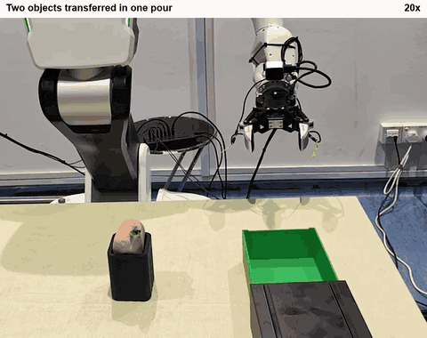</a>

  倾倒完成示例 · 原片全段，已标 20×，GIF 未另加速；单段 shot 条件未标注。

  <a href="https://6uooon9.github.io/GPT-GEAR/assets/videos/1636c688a94c.mp4">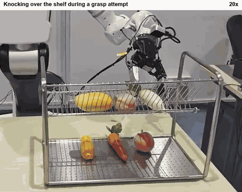</a>

  货架任务失败示例 · 原片全段，已标 20×，GIF 未另加速；单段 shot 条件未标注。

  

  
展开更多示例（3 段 GIF）

  

  倾倒任务失败示例 · 原片全段约 56 秒，原标 20×，GIF 相对原片另加速 2×；单段 shot 条件未标注。

  

  倾倒：物体落到抽屉外 · 原片全段速览，原标 20×，GIF 相对原片另加速 4×；单段 shot 条件未标注，详细过程见原视频。

  

  货架重排成功对照 · 原片全段速览，原标 20×，GIF 相对原片另加速 8×；单段 shot 条件未标注，详细过程见原视频。

  

- **[XLeRobot：移动接近电梯按钮](https://arxiv.org/html/2609.31770v1#S6)** · 📄 实验 · [代码与视频](https://github.com/hesd10/astra-robot-sim2real)

  Sida He 等 · 2026-09-24 · XLeRobot 移动底盘 + 机械臂 · 无历史经验基线

  基线 3/3 达到人工确认的夹爪接触，平均 740.1 秒；未验证按钮确实触发。加入本体文件或历史经验的对照减少了探索耗时，也有沿用旧经验先走错方向再修正的记录。仓库 D3 演示使用经验复用，不是该零样本基线。

  

  D3 经验复用演示，非无经验 zero-shot 基线 · 原片全段约 56 秒，原标 6×，GIF 相对原片另加速 4×；任务判据为接触，不等于确认按钮触发。

- **[ROBOTIS：AI Worker 的恢复与接入经验](https://docs.robotis.com/docs/systems/aiworker/resources/technical_story/codex/#5-observations)** · ▶ [真机视频](https://youtu.be/ZQXV_ngVG20)

  ROBOTIS 硬件团队 · AI Worker SG2 · RGB + 状态；未报告任务示范或训练

  未预先提供桌高和物体坐标，运行中出现降低升降台、用空手拉近篮子等非预写恢复。相同指令的动作序列仍有变化，高低桌间抓放表现较差；缩短单次位移后，测试结果改善，同时增加耗时与 Token。

  

  SG2 双手交接后入篮 · 原片全段，仅裁去左右黑边，保持原片播放速度；未报告任务示范或训练。

  

  
展开更多示例（1 段 GIF）

  

  收桌过程速览 · 原片全段约 45 秒，原标 15×，GIF 相对原片另加速 2×；未报告任务示范或训练。

  

- **[XDOF：任务推进、抓空与等待成本](https://www.xdof.ai/blog/evaluating-llms)** · ▶ [逐次视频与记录](https://benchmarks.xdof.ai/)

  XDOF · 2026-10-23 · 双臂 YAM · 报告称 zero-shot task reasoning，提供本体说明、工具与历史

  运行记录包含任务拆解和反复抓空；Astra 的模型调用耗时约 15 秒（各轨迹平均值的中位数），单任务费用超过 Sol 的 5 倍，整体成功率接近。[19.6%](#四xdof--ember-0)是该套 16 项任务的等权成功率，不是单独的长程能力得分。

  

  Astra HIGH 拉布并抓起玩具 · 原片 03:55–06:42，GIF 相对原片 8×；当前运行库 run 11 标记 Passed，单段任务训练条件未披露。

- **[SenseNova：八种本体与移动操作](https://www.sensenova.cn/has-gpt-6-astra-achieved-embodied-intelligence#real-world)** · ▶ [本体合集](https://www.sensenova.cn/gpt-6/assets/video/realworld/embodiments.mp4) · [G1 演示](https://www.sensenova.cn/gpt-6/assets/video/realworld/g1_system2.mp4)

  SenseNova 联合团队 · 2026-10 · 单双臂、移动平台与 G1 · 真机无示范，提供人工结构化上下文

  记录覆盖刚性物体抓放、柔性与精密操作、移动长任务，后几类暴露出更多执行困难。G1 约 90% 时间用于思考；部分平台另有人工姿态或任务提示，真机重试也需要现场看护，不能只按视频中的动作长度判断自主完成能力。

  

  G1 移动与桌面操作 · 原片全段，保持原片播放速度；原片压缩了长时间思考，不代表实时速度。

[↑ 返回目录](#-目录)

---

## 🤖 破壳 RoboAPI（Poke-Aurora）

破壳的 RoboAPI 由 Poke-Aurora 驱动。这里结合开发者的真机视频、接入体验与失败记录，整理目前能看到的能力。

### 🧠 理解能力

<table>
  <tr><th align="left">能力小结</th></tr>
  <tr><td>⭕️ <strong>相较于 dream1 似乎有更强的感知理解能力。</strong>  已有手机放到香蕉左侧、按颜色顺序叠杯的真机演示；逐视频的任务训练与示范条件未披露，因此目前只能确认有这些操作示例。</td></tr>
</table>

- **[手机放到香蕉左侧](https://assets.pokebot.com/prod/10-30/ai/v21/009.mp4)** · ▶ 原视频

  北京 / 清华 · 2026-10-30 发布合集 · 官方收录的外部 beta

  任务要求移动手机，并使其最终位于香蕉左侧。

  

  空间关系指令：手机放到香蕉左侧 · 原片全段，GIF 相对原片 2×；zero-shot 条件未逐项披露。

- **[按颜色顺序叠三只杯子](https://assets.pokebot.com/prod/10-30/ai/v21/025.mp4)** · ▶ 原视频

  新加坡 / NTU · 2026-10-30 发布合集 · 官方收录的外部 beta

  指令要求先把粉杯叠到蓝杯上，再把绿杯叠到粉杯上。

  

  按颜色顺序叠杯 · 原片全段，GIF 相对原片 2×；zero-shot 条件未逐项披露。

### 🦾 抓取能力

<table>
  <tr><th align="left">能力小结</th></tr>
  <tr><td>❌ <strong>已有抓放演示，zero-shot 条件尚未确认。</strong>  外部实验室展示了桌面物体、茄子和多物体收纳，但任务训练与示范条件未单独披露。南瓜抓取还有未完成记录，暂不确认 zero-shot 抓取能力。</td></tr>
</table>

- **[Princeton：桌面物体抓放](https://x.com/tennyyin/status/2116291386555367561)** · ▶ 视频

  Tenny Yin · 2026-10-31（北京时间） · 实验室单臂 · 社区实测

  视频展示桌面物体抓放，本体具体型号未披露。

  

  桌面物体抓放 · 原片全段，保持原片播放速度；任务训练与示范条件未披露。

- **[茄子放入橙色篮子](https://assets.pokebot.com/prod/10-30/ai/v21/010.mp4)** · ▶ 原视频

  深圳 / 清华 · 2026-10-30 发布合集 · 官方收录的外部 beta

  从桌面抓起茄子，并放入指定的橙色篮子。

  

  茄子抓放 · 原片全段，GIF 相对原片 2×；zero-shot 条件未逐项披露。

- **[把全部物体收进碗里](https://assets.pokebot.com/prod/10-30/ai/v21/004.mp4)** · ▶ 原视频

  Princeton · 2026-10-30 发布合集 · 官方收录的外部 beta

  连续抓取桌面上的多个物体并放入碗中，任务要求全部收纳。

  

  多物体收纳 · 原片全段约 02:22，GIF 相对原片 8×；zero-shot 条件未逐项披露。

- **[四模型抓南瓜：RoboAPI](https://x.com/robot_xyz_rpy/status/2117314589507350695)** · ▶ 视频 · 失败记录

  Ali / Archie / Noah · 2026-11-02 · I2RT YAM · 同台对比

  这套夹爪只能从南瓜柄端可靠提起物体。RoboAPI 多次尝试主体或顶部，展示中未有效提起；训练条件、控制预算和重复次数未统一披露。

  

  RoboAPI 左下画面裁切 · 原片 00:00–00:31，保留原标 16×，GIF 未另加速；未完成有效提起。

### 🪡 精细操作能力

<table>
  <tr><th align="left">能力小结</th></tr>
  <tr><td>❌ <strong>已有对齐与插入演示，zero-shot 条件尚未确认。</strong>  叠杯、面包入槽和插笔都有真机片段；当前资料没有逐项说明是否使用任务示范或训练，不能仅凭成功片段确认 zero-shot 精细操作。</td></tr>
</table>

- **[Boston：红纸杯套叠](https://x.com/HaojieHuang13/status/2116925827388747838)** · ▶ 22 秒视频

  Haojie Huang / Helping Hands Lab · 2026-11-02（北京时间） · 腕相机单臂 · 社区实测

  机械臂抓杯、对齐、套叠并松爪，片段末态可见两个杯子叠在一起。

  

  红纸杯套叠 · 原片全段约 23 秒，保持原片播放速度；片末可见松爪后的套叠状态。

- **[Boston：把面包放入烤面包机](https://x.com/HaojieHuang13/status/2116924942117957868)** · ▶ 视频 · [官方收录片段](https://assets.pokebot.com/prod/10-30/ai/v21/013.mp4)

  Haojie Huang / Helping Hands Lab · 2026-11-02（北京时间） · 实验室单臂 · 外部试用

  视频展示抓起面包并放入烤面包机槽口。[开发者回复](https://x.com/HarryXu12/status/2116930703447474647)明确“一条指令做早餐”仍是后续目标；本条的完成范围为面包入槽。

  

  面包入槽 · 原片全段，保持原片播放速度；不代表完成整套早餐任务。

- **[上海：记号笔插入笔筒](https://assets.pokebot.com/prod/10-30/ai/v21/000.mp4)** · ▶ 原视频

  上海 / 官方外部 beta · 2026-10-30 发布合集

  机械臂抓持记号笔、调整朝向并插入笔筒。

  

  对齐并插笔 · 原片全段，GIF 相对原片 2×；zero-shot 条件未逐项披露。

### 🧩 长程任务能力

<table>
  <tr><th align="left">能力小结</th></tr>
  <tr><td>❌ <strong>尚无条件明确的真机 zero-shot 长程成功证据。</strong>  抽屉收纳片段未披露完整运行与训练条件；Allen 的重试记录来自仿真。当前材料不足以确认自主完成整段长程任务。</td></tr>
</table>

- **[把全部物体放进抽屉](https://assets.pokebot.com/prod/10-30/ai/v21/020.mp4)** · ▶ 原视频

  雄安 / 官方外部 beta · 2026-10-30 发布合集

  任务要求把多个物体连续搬入抽屉；持续时间、重置与重复次数未披露。

  

  连续收纳演示 · 原片全段约 01:57，GIF 相对原片 6×；完整运行与训练条件见上述记录。

- **[仿真补充：首次运行与自主重试](https://x.com/allen_datumwell/status/2116162233705390149)** · ▶ 视频 · **非真机**

  Allen / Datumwell · 2026-10-30 · 仿真单臂 · 作者报告 zero-shot

  原帖报告首次运行完成任务，并记录出错后的自主重试。[开发者回复](https://x.com/HarryXu12/status/2116795098885456139)确认这是仿真；不计入真机或长程成功率。

  

  仿真补充 · 原片全段，保持原片播放速度；非真机，该短片不覆盖帖子提及的全部重试过程。

[↑ 返回目录](#-目录)

---

## 🤖 Gemini

Gemini 出现在南瓜、Cortex 和 RoboCurve 等对比中。各评测的模型配置与控制接口不同，下面按任务记录具体表现。

### 🧠 理解能力

<table>
  <tr><th align="left">能力小结</th></tr>
  <tr><td>❌ <strong>当前未收录可确认理解能力的真机 zero-shot 演示。</strong>  需要补充能单独观察目标选择、空间关系或指令约束的成功记录，并明确实验条件。</td></tr>
</table>

### 🦾 抓取能力

<table>
  <tr><th align="left">能力小结</th></tr>
  <tr><td>❌ <strong>已有真机抓取成功轨迹，zero-shot 条件尚未确认。</strong>  XDOF 当前运行库已有拉布后抓起毛绒玩具的成功记录，南瓜展示仍有失败。新轨迹未完整披露任务训练或示范条件，因此目前可以确认该配置完成过抓取，尚不能确认其 zero-shot 条件。</td></tr>
</table>

- **[XDOF：拉近毛绒玩具并抓起](https://benchmarks.xdof.ai/)** · ▶ [完整轨迹](https://benchmark-assets.xdof.ai/media/episode-70133dff2272e012-top-605e7450f8f1.mp4)

  XDOF 当前公开运行库 · 2026-11-05 核对 · Gemini 4 Argon HIGH · 任务训练与示范条件未逐项披露

  `ep_70133dff2272e012`、run 6 标记为 **Passed**。画面显示先拉动红布把毛绒玩具带近，再调整夹爪并抓起。这是一个具体配置的单次成功，不能据此计算重复成功率；该配置不并入上方 2026-10-23 的五模型排名。

  

  Gemini 4 Argon HIGH 拉布并抓起玩具 · 原片 04:25–07:49.55，GIF 相对原片 8×；run 6 标记 Passed，zero-shot 条件未确认。

- **[四模型抓南瓜：Gemini](https://x.com/robot_xyz_rpy/status/2117314589507350695)** · ▶ 视频

  Ali / Archie / Noah · I2RT YAM · 同台对比

  失败 / 限制 · Gemini 接近柄部，但未稳定夹住。

  

  Gemini 右下画面裁切 · 原片 00:00–00:31，保留原标 16×，GIF 未另加速；未完成稳定抓取。

### 🪡 精细操作能力

<table>
  <tr><th align="left">能力小结</th></tr>
  <tr><td>❌ <strong>当前未确认真机 zero-shot 精细操作成功。</strong>  Cortex 的任务得分包含中间步骤，且 zero-shot 条件未披露；现有记录不足以确认完整精细操作的 zero-shot 成功。</td></tr>
</table>

- **[Cortex：Gemini 精密任务对照](https://cortexrobot.ai/research/llm-real-world-robotics-evals/)** · ▶ 视频合集

  Cortex AI Research · I2RT YAM BOX · 同台对比

  补充资料 · Gemini 使用同一评测协议，报告得分较低；具体轨迹需回到原页查看。

### 🧩 长程任务能力

<table>
  <tr><th align="left">能力小结</th></tr>
  <tr><td>❌ <strong>当前未确认真机 zero-shot 完整长程任务成功。</strong>  RoboCurve 已有叠三碗完整成功的单次记录，支持有限步骤的连续操作；任务训练与示范条件未完整披露。48.2% 仍是汇总进度分，不能代替完整完成率，也不能从一个成功片段推断长程可靠性。</td></tr>
</table>

- **[RoboCurve：Gemini 逐次运行](https://robocurve.org/all-runs/?benchmark=robodojo-rc-tier-1)** · ▶ 视频合集

  RoboCurve · I2RT YAM · 独立量化评测

  Gemini 该配置的平均进度分为 48.2%，完整完成情况需另看逐次记录。

  叠碗 trial 1 `adhoc_fafe5fb4` 的[独立记录](https://robocurve.org/all-runs/records.2a44f77b200f/robodojo-omen_rig-2_adhoc_fafe5fb4.json)与[日志](https://runs.robocurve.org/roboharm-3a29910c/logs/omen_rig-2_adhoc_fafe5fb4.html)标记 complete：Gemini 4 Argon、high / priority，17 次调用，运行约 301 秒。系统提示包含机器人参数与通用抓放步骤；任务训练与示范条件未完整披露。下方是约 5 秒的压缩日志回放。

  

  Gemini 4 Argon high，叠碗 trial 1 · 原片全段约 5.27 秒，是日志压缩回放；实际运行约 301 秒，GIF 保持源片播放速度，不能解读为 5 秒完成任务。

[↑ 返回目录](#-目录)

## 🤝 一起补充

如果你看到某个模型的真机复现，可以按照 **模型 → 能力 → ✅ / ❌ / ⭕️ 初步结论 → 支撑案例与反例** 来补充。研究者的使用反馈也可以作为判断依据，请附上原始来源和具体观察，帮助我们继续修正理解。

欢迎直接通过 Issue 或 PR 补充研究者、模型、任务条件、观察结果和原始视频链接，或修改本 README。
