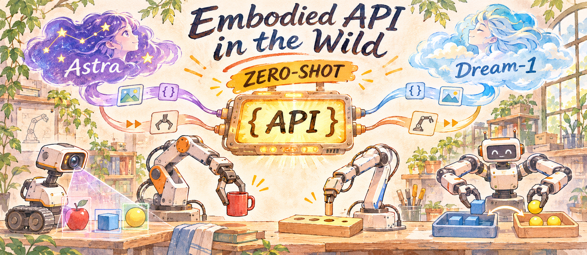

  

<h1 align="center">🤖 Embodied API in the Wild</h1>

  <em>看看各路研究者的 zero-shot 复现，理解模型在真实机器人上能做什么</em>

  <strong>It’s amazing what you can learn if you’re not afraid to try.</strong>

  <em>—— Robert A. Heinlein, Have Space Suit–Will Travel</em>

---

## 写在前面

模型在真实机器人上到底表现如何？我把一些公开的 zero-shot 复现放在一起，从实际任务和视频里看看各大 api zero-shot 的能力（目前包括 astra、dream1、破壳 api）。

整个项目分为了两个部分去整理：

1. **Benchmark**，看不同模型在同一套任务中的表现；
2. 不同模型 zero-shot 能力表现，分析**理解能力、抓取能力、精细操作能力和长程任务能力**，并总结对于这些 api 泛化能力的感受；

这些初步结论综合 **实验结果、视频表现和研究者的使用反馈**。每条案例保留研究者、实验条件、具体结果和原始来源，方便核对与更新。

**来源标识**：**【官方】** 指模型开发方的演示或自评；**【第三方】** 指外部研究者、团队或用户的记录。合作方演示也归为第三方，由模型官网选录的片段另注“官方收录”。

**卡片结果**：按卡片所列任务与实验条件判断。🟩 **成功（绿框）**：当前收录中至少有一次完整任务成功；🟥 **失败（红框）**：当前收录中没有完整任务成功记录。局部动作或中间步骤得分不算完整成功。卡片可能展示失败片段，颜色仍按同任务、同条件的已收录结果判定。

如果你也对具身智能的 zero-shot 复现感兴趣，欢迎与我交流、分享实验和观察，一起共建这个项目！： 📧：[yirongzzz@163.com](mailto:yirongzzz@163.com)

## 📋 目录

| 章节 | 内容 |
| --- | --- |
| [📊 Benchmark](#-benchmark) | 多模型对比、任务设置与评测结果 |
| [🤖 Dream-1](#-dream-1) | [理解能力](#-理解能力) · [抓取能力](#-抓取能力) · [精细操作能力](#-精细操作能力) · [长程任务能力](#-长程任务能力) |
| [🤖 GPT-6 Astra](#-gpt-6-astra) | [理解能力](#-理解能力-1) · [抓取能力](#-抓取能力-1) · [精细操作能力](#-精细操作能力-1) · [长程任务能力](#-长程任务能力-1) |
| [🤖 破壳 RoboAPI](#-破壳-roboapipoke-aurora) | [理解能力](#-理解能力-2) · [抓取能力](#-抓取能力-2) · [精细操作能力](#-精细操作能力-2) · [长程任务能力](#-长程任务能力-2) |
| [🤖 Gemini](#-gemini) | [理解能力](#-理解能力-3) · [抓取能力](#-抓取能力-3) · [精细操作能力](#-精细操作能力-3) · [长程任务能力](#-长程任务能力-3) |

## 📊 Benchmark

先看同一套任务里不同模型的表现。这里整理多模型评测与同台测试，关注 zero-shot 复现，也保留有示范或微调的对照。每项评测的训练条件与计分方式分别记录。

**任务难度（满分 3🌟）**：按公开任务设置作个人判断。🌟 以基础抓放或简单姿态调整为主；🌟🌟 加入目标筛选、空间对齐或连续步骤；🌟🌟🌟 涉及高精度接触、柔性物体、复杂双臂协作或多重任务约束。星级描述任务要求，模型表现另看评测结果。

**评测来源**：包含了官方与第三方的评测，个人认为以第三方的评测效果为主。

### 一、RoboCurve · RoboDojo-RC Tier 1

**【第三方】** **RoboCurve · 2026-10-19**　[▶ 视频 / 记录](https://robocurve.org/all-runs/?benchmark=robodojo-rc-tier-1)

**任务介绍：** 双臂 I2RT YAM 上的六类桌面操作，从分类、摆放到双臂对齐与连续搬运。每项按中间步骤计分，完整完成还要满足最终状态。[任务指令与评分规则](https://robocurve.org/opus-5-5-robodojo-rc-tier-1/)

| 任务 | 要完成什么 / 难点 | 难度 |
| --- | --- | --- |
| 堆碗 | 将三个碗叠稳，连续放置时保持对齐。 | 🌟🌟 |
| 物体分类 | 把两类物体分别放进两个篮子，不能混放或遗漏。 | 🌟🌟 |
| 竖起瓶子 | 将三个瓶子全部竖直放稳，需要反复调整抓取与放置姿态。 | 🌟🌟 |
| 收纳并关箱 | 把三个物体放入保险箱，再把盖子关上。 | 🌟🌟 |
| 套笔帽 | 两臂分别拿住笔和笔帽，对齐后套牢。 | 🌟🌟🌟 |
| 装水果再倾倒 | 把三件水果装入小碗，再全部倒进大碗，保持物体与容器受控。 | 🌟🌟🌟 |

**对比模型：** Dream-1 / GPT-6 Astra / Gemini

**评测方原图**

  

来源：[RoboCurve 官方主页](https://robocurve.org/)，2026-11-04 页面快照。图中为**平均任务进度分**，数值取整；包含更多模型配置。LLM 最多 40 次模型调用，VLA 最多 3,600 个控制步。

| 模型 | 来源报告或展示的结果 |
| --- | --- |
| Dream-1 | 59.3% 平均任务进度得分；完整完成约 31/120（[公开日志的二次统计](https://aiwiki.ai/wiki/dream_1)，非官方成功率） |
| GPT-6 Astra | 最高列出的 high/fast 配置平均分 42.5% |
| Gemini | Gemini 4 Argon high/priority 配置平均分 48.2% |

### 二、OpenRUA · 19 类真机任务

**【第三方】** **OpenRUA Team · 2026-11-03**　[📄 报告](https://openrua.ai/uni-robot-agent)

**任务介绍：** 在真实双臂机器人上设置 19 项任务，覆盖空间理解、物体泛化、指令遵循、组合泛化与未见任务。下面选取六个代表任务，完整列表见[原文 §3.2 / Table 3](https://openrua.ai/uni-robot-agent)。

| 代表任务 | 要完成什么 / 难点 | 难度 |
| --- | --- | --- |
| 水果抓放 | 识别目标水果并完成抓取、放置。 | 🌟 |
| 按颜色叠杯 | 按要求的颜色顺序叠杯，同时保持堆叠稳定。 | 🌟🌟 |
| 折抹布 | 操作柔性物体，控制布料变形并完成折叠。 | 🌟🌟🌟 |
| 试管入架 | 将试管对准架孔并插入，位置和姿态都需要准确。 | 🌟🌟🌟 |
| 双臂交接瓶子 | 两臂协调接管物体，交接时保持稳定抓持。 | 🌟🌟🌟 |
| 汉诺塔 | 按任务约束移动圆盘并组成三层塔，需要规划与状态跟踪。 | 🌟🌟🌟 |

**对比模型：** Dream-1 / GPT-6 Astra / Qwen / π0.5

**能力分项对比**

  

来源：[OpenRUA · Table 2](https://openrua.ai/uni-robot-agent#real-eval-summary)，原网页表格截图。**每个能力维度满分 20，总分 100**；π₀.₅ 经微调，Astra / Qwen 使用深度信息，Dream-1 / π₀.₅ 仅用 RGB。

<table>
  <tr><th align="left">📝 备注</th></tr>
  <tr><td>在这个 benchmark 下，astra 和 qwen 并非端到端的输出，采用的是 Agent 形式</td></tr>
</table>

### 三、破壳 · RoboAPI 官方任务评测

**【官方】** **PokeBot · 2026-10-30**　[📄 报告 / ▶ 任务视频](https://pokebot.com/ai)

**任务介绍：** 官方自建评测覆盖转移整理、姿态形状对齐、环境交互三类操作。页面称任务框架包含近 1,000 个物体实例、近 10,000 条不同指令；这两个数字不能直接当作每个模型的测试次数。

| 代表任务 | 要完成什么 / 难点 | 难度 |
| --- | --- | --- |
| 衣物分类入篮 | 按指令选对衣物和容器，完成抓放。 | 🌟🌟 |
| 翻包装露出条码 | 调整物体朝向，使指定一面可见。 | 🌟🌟 |
| T 形块对齐目标 | 同时对准位置和朝向。 | 🌟🌟🌟 |
| 毛巾对折 | 抓住合适位置，控制布料变形。 | 🌟🌟🌟 |
| 开关抽屉 | 抓住把手，并沿抽屉运动方向施力。 | 🌟🌟 |
| 擦除指定图形 | 选对区域，维持工具接触并检查擦除结果。 | 🌟🌟 |

**对比模型：** Poke-Aurora（RoboAPI） / GPT-6 Astra / π₀.₅ / MolmoAct2

  

来源：[破壳官方发布页](https://pokebot.com/ai)，2026-11-04 页面快照。三组 Poke-Aurora / Astra 成功率依次为 86.0% / 71.3%、54.1% / 36.3%、87.7% / 67.9%；图中另含 π₀.₅ 与 MolmoAct2。

<table>
  <tr><th align="left">📝 小结</th></tr>
  <tr><td><strong>我的理解：</strong>这组结果可以帮助选择值得优先复现的任务，但还不足以判断换一个实验室后能否保持相同优势。要验证泛化，需要结合下方外部案例，并在一致条件下重复测试。  <strong>Zero-shot 条件：</strong>官方将 RoboAPI 定位为无需针对新任务额外采集数据或训练的接口；本组各模型的微调、示范、重复次数与预算未完整披露。图中是官方报告的分类成功率，暂不作为独立复现的统一排名。</td></tr>
</table>

### 四、XDOF · Ember-0

**【第三方】** **XDOF · 2026-10-23 原报告**　[▶ 视频 / 记录](https://benchmarks.xdof.ai/)

**任务介绍：** Ember-0 在双臂 YAM 上设置 16 类操作任务，同时考察空间推理、工具使用、精细接触和连续执行。下面列出代表任务；每项记录中间步骤与最终是否成功。[评测方任务说明](https://www.xdof.ai/blog/evaluating-llms)

| 代表任务 | 要完成什么 / 难点 | 难度 |
| --- | --- | --- |
| 竖起倒瓶 | 调整倒放瓶子的姿态，让它竖直放稳。 | 🌟 |
| 拉毛巾取玩具 | 先拉近毛巾，再拿到原本够不着的玩具，需要判断间接作用。 | 🌟🌟 |
| 用夹钳夹面包 | 正确抓持并操纵夹钳，让工具夹住面包。 | 🌟🌟🌟 |
| 不碰球让球入碗 | 倾斜托盘使球滚进碗，控制方向与运动过程。 | 🌟🌟🌟 |
| 展开 T 恤 | 双臂控制衣角，处理布料不断变化的形状。 | 🌟🌟🌟 |
| 托盘上准备麦片餐 | 连续完成盛放与摆放步骤，跟踪进度并协调双臂。 | 🌟🌟🌟 |

**对比模型：** GPT-6 Astra / GPT-6.1 Sol / Fable 5.1 / Opus 5.5 / Meta Muse

**整体成功率对比**

  

来源：[XDOF 原报告](https://www.xdof.ai/blog/evaluating-llms) · [原图](https://www.xdof.ai/blog/evaluating-llms/results.png)。采用 **16 项任务成功率的等权平均**，误差线为 95% bootstrap 区间；这组对比不含 Gemini 和 Dream-1。

<strong>展开：16 项任务的逐模型成功率</strong>

  

[逐任务原图](https://www.xdof.ai/blog/evaluating-llms/task-success.png)。每格同时给出成功率与成功次数 / 有效运行次数；`Overall` 行合并全部运行计算，与上图按任务等权平均的口径不同。

<table>
  <tr><th align="left">📝 阅读备注</th></tr>
  <tr><td><strong>任务设置：</strong>16 类真机任务；逐任务成功率与运行预览  <strong>阅读备注：</strong>图表采用原报告的五模型结果；逐任务完成率便于对照上面的任务难度。Dream-1 的早期预览测试另列，未参与本组排名。  <strong>Zero-shot 条件：</strong>原报告称 zero-shot task reasoning：模型依据任务描述推理，控制栈提供相机、本体说明、历史与工具；不据此推断闭源预训练数据完全未见这些任务。</td></tr>
</table>

### 五、Cortex · 微波炉与移液器

**【第三方】** **Cortex AI Research · 2026-09-17**　[▶ 视频 / 记录](https://cortexrobot.ai/research/llm-real-world-robotics-evals/)

**任务介绍：** 在同一双臂 YAM BOX 上完成两项任务：把三明治送入微波炉并关门，以及给移液器装上 5 mm 吸头。每次最长 10 分钟，完成中间步骤也可得分。[原始任务与演示](https://cortexrobot.ai/research/llm-real-world-robotics-evals/)

| 任务 | 要完成什么 / 难点 | 难度 |
| --- | --- | --- |
| 三明治放进微波炉并关门 | 放入食物，处理突出门口的托盘，再关好门并检查，涉及步骤衔接与接触控制。 | 🌟🌟 |
| 安装 5 mm 移液器吸头 | 对准小吸头并装牢；还需要识别未装上的情况，重新对齐尝试。 | 🌟🌟🌟 |

**对比模型：** GPT-6 Astra / Gemini 3.8 Flash / Fable 5.1

**两项任务得分对比**

  
  

来源：[Cortex 原报告](https://cortexrobot.ai/research/llm-real-world-robotics-evals/)（2026-09-17）。左图为微波炉任务，右图为移液器任务，点击可看大图。三模型均使用 medium reasoning；**任务得分包含中间步骤，不等于完整成功率**。

<table>
  <tr><th align="left">📝 小结</th></tr>
  <tr><td><strong>任务设置：</strong>同一 YAM BOX 平台，顶视与双腕相机；两项操作任务，每次最长 10 分钟  <strong>阅读备注：</strong>各模型均使用深度图像，按中间步骤评分。任务 zero-shot 条件未披露，进度得分不能当作完整任务成功率。  <strong>Zero-shot 条件：</strong>现有收录资料未明确披露任务训练、微调或示范条件，暂不认定为已报告的 zero-shot。</td></tr>
</table>

### 六、四模型抓南瓜

**【第三方】** **Ali / Archie / Noah · 2026-11-02**　[▶ 视频 / 记录](https://x.com/robot_xyz_rpy/status/2117314589507350695)

**任务介绍：** 用 YAM 夹爪抓起南瓜并放进盒子。测试者说明，该夹爪只能通过南瓜柄端可靠提起物体，因此需要先找到可抓位置，再完成夹持、搬运和放置。[测试者原帖](https://x.com/robot_xyz_rpy/status/2117314589507350695)

| 任务 | 要完成什么 / 难点 | 难度 |
| --- | --- | --- |
| 抓南瓜入盒 | 选择柄端而非主体，准确闭合夹爪；抓空后判断是否需要换位置。 | 🌟🌟 |

**对比模型：** Dream-1 / GPT-6 Astra / RoboAPI / Gemini

| 模型 | 来源报告或展示的结果 | 成功率 / 进度分 |
| --- | --- | --- |
| Dream-1 | 先尝试抓主体，随后改抓柄部并完成放置 | 未测试 |
| GPT-6 Astra | 尝试对准柄部，但夹爪闭合位置过高 | 未测试 |
| RoboAPI | 多次尝试主体或顶部，未完成有效提起 | 未测试 |
| Gemini | 接近柄部，但未稳定夹住 | 未测试 |

四模型同台片段 · 原片全段约 46 秒，GIF 相对原片 2×。原片中 Dream-1 为 1×，其余为 16×，不可据此比较执行速度。

---

<table>
  <tr><th align="left">能力评级（满分 5⭐）</th></tr>
  <tr><td>依据当前收录的第三方真机结果与研究者反馈做个人初评；官方演示作为补充，不单独作为能力成立的依据。星级评价已展示的能力，zero-shot 条件另行注明。  ⭐ <strong>较弱：</strong>以失败或局部进展为主。 ⭐⭐ <strong>初步：</strong>已有少量完整成功，但执行不稳定或任务范围较窄。 ⭐⭐⭐ <strong>具备基础能力：</strong>多种任务或重复运行已有成功，复杂条件下仍有明显局限。 ⭐⭐⭐⭐ <strong>较强：</strong>多类任务的重复评测较稳定，并有跨场景表现支持。 ⭐⭐⭐⭐⭐ <strong>成熟：</strong>复杂任务、不同场景下持续稳定，并有自主纠错与恢复记录支持。  缺少对应真机材料时标注<strong>“暂不评级”</strong>。能力星级不等于成功率，也不同于 Benchmark 的 3🌟 任务难度；卡片红绿框仍只表示对应任务是否有过完整成功。</td></tr>
</table>

## 🤖 Dream-1

Dream-1 的公开复现支持一个初步判断：基础抓放已经有跨本体的能力，但指令约束、精确接触和完整任务执行仍有明显缺口。

### 🧠 理解能力

<table>
  <tr><th align="left">能力小结 · ⭐（1/5）</th></tr>
  <tr><td><strong>对于环境的感知理解能力较弱，对于物体的类别泛化能力较弱，但有成功案例</strong>  Eastworld 的 <a href="https://dreamlabs.ai/research/dream-1/assets/beta/eastworld.mp4">zero-shot 苹果入盒</a>提供了成功例子；SE3 的错箱、违反禁抓约束和 Blupe 的选错目标说明，复杂约束遵循仍有明确失败。</td></tr>
</table>

<table align="center" style="width:600px;max-width:100%;margin-left:auto;margin-right:auto;">
  <tr>
    <td align="center" valign="top" width="270" style="border:1px solid #cf222e;box-shadow:inset 0 0 0 4px #cf222e;">
      
        
      <strong>【第三方】</strong> <strong style="color:#cf222e;">🟥 失败</strong>
       
      <strong><a href="https://se3labs.ai/blog/dream-eval-1/#instructions">SE3 · 推齐积木的指令约束</a></strong>
       
      SE3 Labs · 2026-10-30 双臂真机 · zero-shot · 本任务 10 次 要求用尺子推齐，却违反“不得拿起积木”约束 原片全段 · 原标 2×，GIF 未另加速 <a href="https://docs.se3labs.ai/tasks/robodojo-real/">任务与评分规则</a> <strong>完整成功率：0%（0/10） <a href="https://se3labs.ai/blog/dream-eval-1/#episodes">平均进度分：1/100（10 次均值）</a></strong>
    </td>
    <td align="center" valign="top" width="270" style="border:1px solid #cf222e;box-shadow:inset 0 0 0 4px #cf222e;">
      
        
      <strong>【第三方】</strong> <strong style="color:#cf222e;">🟥 失败</strong>
       
      <strong><a href="https://se3labs.ai/blog/dream-eval-1/#instructions">SE3 · 按语言分类</a></strong>
       
      SE3 Labs · 2026-10-30 双臂真机 · zero-shot · 本任务 10 次 将物体放进错误箱子，未完成分类 原片全段 · 原标 2×，GIF 未另加速 <a href="https://docs.se3labs.ai/tasks/robodojo-real/">任务与评分规则</a> <strong>完整成功率：0%（0/10） <a href="https://se3labs.ai/blog/dream-eval-1/#episodes">平均进度分：8.5/100（10 次均值，原图取整为 9）</a></strong>
    </td>
  </tr>
</table>

#### 更多案例

1. **【第三方】** **[Blupe 社区试用：要苹果，却抓红积木](https://www.reddit.com/r/robotics/comments/1xaz5ve/dream_labs_dropped_a_monster/)**

   u/Lumpy_Week7304 · 2026-10

   **任务：** 按指令移动苹果；作者报告机械臂实际抓红积木且持续动作。尚未取回原视频，动作描述来自作者陈述；附有 [Blupe Playground](https://playground.blupe.io/) 体验入口。

   **成功率 / 进度分：** 未测试（未公开统计）。**任务耗时：** 未披露。

2. **【第三方】** **[XDOF：红色便签的指令推理](https://x.com/xdofai/status/2112252852257353761)** · 📄 [图文评价](https://x.com/xdofai/status/2112252855222673530)

   XDOF · 2026-10-19 · 真机双臂评测平台 · 早期预览版，任务训练条件未披露

   **任务：** 遵循红色便签的指令；**作者评价推理表现不足，未给出逐次结果**。所链记录仅含图文，未附对应任务视频。

   **成功率 / 进度分：** 未测试（未公开统计）。**任务耗时：** 未披露。

### 🦾 抓取能力

<table>
  <tr><th align="left">能力小结 · ⭐⭐⭐（3/5）</th></tr>
  <tr><td><strong>已有基础抓放的真机 zero-shot 演示。</strong>  小林的自制机械臂抓塑料瓶、毛绒玩具，以及 Eastworld 的苹果入盒，支持基础抓取能力。SO-101 的反复失败表明，这项能力尚不能在所有配置上稳定复现。</td></tr>
</table>

<table align="center">
  <tr>
    <td align="center" valign="top" width="33%" style="border:1px solid #1a7f37;box-shadow:inset 0 0 0 4px #1a7f37;">
      
        
      <strong>【第三方】</strong> <strong style="color:#1a7f37;">🟩 成功</strong>
       
      <strong><a href="https://x.com/Ryan_Resolution/status/2115320267438506302">Maker Arm Station · 抓青柠</a></strong>
       
      Ryan Chan / MakerMods · 作者自述 zero-shot 抓青柠入篮 · 原片速度 <strong>成功率 / 进度分：未测试</strong>
    </td>
    <td align="center" valign="top" width="33%" style="border:1px solid #1a7f37;box-shadow:inset 0 0 0 4px #1a7f37;">
      
        
      <strong>【第三方】</strong> <strong style="color:#1a7f37;">🟩 成功</strong> 官方收录
       
      <strong><a href="https://x.com/eastworlds_io/status/2114613622047486011">Eastworlds · 苹果入盒</a></strong>
       
      马来西亚双臂平台 · 合作方自述 zero-shot 苹果抓起并入盒 · 原片速度 <strong>成功率 / 进度分：未测试</strong>
    </td>
    <td align="center" valign="top" width="33%" style="border:1px solid #1a7f37;box-shadow:inset 0 0 0 4px #1a7f37;">
      
        
      <strong>【第三方】</strong> <strong style="color:#1a7f37;">🟩 成功</strong> 官方收录
       
      <strong><a href="https://dreamlabs.ai/research/dream-1/assets/beta/mecka.mp4">Mecka · 从架子抓起试管</a></strong>
       
      合作方演示 · 训练条件未披露 仅展示试管抓取 · GIF 2× <strong>成功率 / 进度分：未测试</strong>
    </td>
  </tr>
</table>

<table align="center">
  <tr>
    <td align="center" valign="top" width="33%" style="border:1px solid #1a7f37;box-shadow:inset 0 0 0 4px #1a7f37;">
      
        
      <strong>【第三方】</strong> <strong style="color:#1a7f37;">🟩 成功</strong>
       
      <strong><a href="https://x.com/robot_xyz_rpy/status/2117314589507350695">南瓜 · 改抓柄部后入盒</a></strong>
       
      I2RT YAM · zero-shot 条件未披露 完成放置 · GIF 2× <strong>成功率 / 进度分：未测试</strong>
    </td>
    <td align="center" valign="top" width="33%" style="border:1px solid #cf222e;box-shadow:inset 0 0 0 4px #cf222e;">
      
        
      <strong>【第三方】</strong> <strong style="color:#cf222e;">🟥 失败</strong>
       
      <strong><a href="https://x.com/praneethsamine/status/2113107614796046572">SO-101 · 抓除臭剂瓶</a></strong>
       
      SO-101 单臂 · 明确无微调 跨调试配置 · 原片速度 <strong>作者报告：20 多次，0 次完成</strong>
    </td>
    <td align="center" valign="top" width="33%" style="border:1px solid #cf222e;box-shadow:inset 0 0 0 4px #cf222e;">
      
        
      <strong>【第三方】</strong> <strong style="color:#cf222e;">🟥 失败</strong>
       
      <strong><a href="https://x.com/BharatJain/status/2114104114791715084">移动 SO-101 · 抓积木</a></strong>
       
      移动平台 · zero-shot 尝试 未完成抓放，支架损坏 · 原片速度 <strong>成功率 / 进度分：未测试</strong>
    </td>
  </tr>
</table>
#### 更多案例

1. **【第三方】自制机械臂抓取**

   小林竜太（Ryota Kobayashi） · 2026-10-25 · 个人自制机器人 · 作者明确称 zero-shot

   **任务：** [抓持塑料瓶](https://x.com/CH1H160/status/2114285244325265494)、[夹持毛绒玩具](https://x.com/CH1H160/status/2114344652036096491)。

   **成功率：** 两项均未测试（未公开重复统计）。**任务耗时：** 两项均未披露。

### 🪡 精细操作能力

<table>
  <tr><th align="left">能力小结 · ⭐⭐（2/5）</th></tr>
  <tr><td><strong>精细操作已有个别成功，对准插入仍不稳定。</strong>  合作方 KAIST 的折盒片段已完成，但逐任务训练条件未披露。SE3 的试管插入、套柱均为 0/10 完整成功；试管虽有 9/10 次抬起，仍只是中间步骤。当前支持有限操作能力，尚不能确认稳定的 zero-shot 精细执行。</td></tr>
</table>

<table align="center" style="width:900px;max-width:100%;margin-left:auto;margin-right:auto;">
  <tr>
    <td align="center" valign="top" width="270" style="border:1px solid #cf222e;box-shadow:inset 0 0 0 4px #cf222e;">
      
        
      <strong>【第三方】</strong> <strong style="color:#cf222e;">🟥 失败</strong>
       
      <strong><a href="https://se3labs.ai/blog/dream-eval-1/#episodes">SE3 · 试管插入</a></strong>
       
      SE3 Labs · 2026-10-30 双臂真机 · zero-shot · 本任务 10 次 9/10 次抬起至少一根试管，0/10 次进入指定孔 第 3 次任务完整预览：抬起后倒在架上 原标 10× · GIF 未另加速 <strong>完整成功率：0%（0/10） <a href="https://se3labs.ai/blog/dream-eval-1/#episodes">平均进度分：9/100（10 次均值）</a></strong>
    </td>
    <td align="center" valign="top" width="270" style="border:1px solid #cf222e;box-shadow:inset 0 0 0 4px #cf222e;">
      
        
      <strong>【第三方】</strong> <strong style="color:#cf222e;">🟥 失败</strong>
       
      <strong><a href="https://se3labs.ai/blog/dream-eval-1/#episodes">SE3 · 套柱</a></strong>
       
      SE3 Labs · 2026-10-30 双臂真机 · zero-shot · 本任务 10 次 套柱板靠近中央，未完成正确插入 原片全段 · 原标 2×，GIF 未另加速 <strong>完整成功率：0%（0/10） <a href="https://se3labs.ai/blog/dream-eval-1/#episodes">平均进度分：10/100（10 次均值）</a></strong>
    </td>
    <td align="center" valign="top" width="270" style="border:1px solid #1a7f37;box-shadow:inset 0 0 0 4px #1a7f37;">
      
        
      <strong>【第三方】</strong> <strong style="color:#1a7f37;">🟩 折盒成功</strong> 官方收录
       
      <strong><a href="https://dreamlabs.ai/research/dream-1/">合作方 · 折盒子与移液器</a></strong>
       
      KAIST / Cortex · 2026-10 · 外部双臂平台 <a href="https://dreamlabs.ai/research/dream-1/assets/beta/kaist.mp4">▶ KAIST 折盒子</a> · <a href="https://dreamlabs.ai/research/dream-1/assets/beta/cortex.mp4">▶ Cortex 移液器</a> 折盒片段已完成 · 移液器完整结果未确认 逐任务训练条件未披露 折盒 GIF：原片全段，保持原片播放速度 <strong>成功率 / 进度分：两项均未测试（未公开统计）</strong>
    </td>
  </tr>
</table>

<table align="center">
  <tr>
    <td align="center" valign="top" width="33%" style="border:1px solid #1a7f37;box-shadow:inset 0 0 0 4px #1a7f37;">
      
        
      <strong>【官方】</strong> <strong style="color:#1a7f37;">🟩 成功</strong>
       
      <strong><a href="https://dreamlabs.ai/research/dream-1/assets/demo/8.mp4">插吸管</a></strong>
       
      原片全段 · 原片速度 官方精选 · 训练条件未完整披露 <strong>成功率 / 进度分：未测试</strong>
    </td>
    <td align="center" valign="top" width="33%" style="border:1px solid #1a7f37;box-shadow:inset 0 0 0 4px #1a7f37;">
      
        
      <strong>【官方】</strong> <strong style="color:#1a7f37;">🟩 成功</strong>
       
      <strong><a href="https://dreamlabs.ai/research/dream-1/assets/demo/7.mp4">折衣服</a></strong>
       
      原片全段 · GIF 相对原片 2× 官方精选 · 训练条件未完整披露 <strong>成功率 / 进度分：未测试</strong>
    </td>
    <td align="center" valign="top" width="33%" style="border:1px solid #1a7f37;box-shadow:inset 0 0 0 4px #1a7f37;">
      
        
      <strong>【官方】</strong> <strong style="color:#1a7f37;">🟩 成功</strong>
       
      <strong><a href="https://dreamlabs.ai/research/dream-1/assets/demo/9.mp4">海绵擦拭</a></strong>
       
      原片全段 · 原片速度 官方精选 · 训练条件未完整披露 <strong>成功率 / 进度分：未测试</strong>
    </td>
  </tr>
</table>

### 🧩 长程任务能力

<table>
  <tr><th align="left">能力小结 · ⭐⭐（2/5）</th></tr>
  <tr><td><strong>已有有限多步骤任务完成记录，复杂长程能力仍待验证。</strong>  第三方 RoboCurve 的叠三碗 trial 4 标记 complete，Metal Arm 也展示了连续收纳工具；任务范围和重复统计仍有限。SE3 的分类与装箱均为 0/10 完整成功。官方 Dexmate 演示作为组合系统补充，其规划与导航由外部模块承担。</td></tr>
</table>

<table align="center" style="width:600px;max-width:100%;margin-left:auto;margin-right:auto;">
  <tr>
    <td align="center" valign="top" width="270" style="border:1px solid #cf222e;box-shadow:inset 0 0 0 4px #cf222e;">
      
        
      <strong>【第三方】</strong> <strong style="color:#cf222e;">🟥 失败</strong>
       
      <strong><a href="https://se3labs.ai/blog/dream-eval-1/#skills">SE3 · 物体分类与纠错</a></strong>
       
      双臂真机 · zero-shot · 本任务 10 次 单次上限 180 秒 · 局部纠错，分类未完成 原片全段 · 原标 2×，GIF 未另加速 <strong>完整成功率：0%（0/10） <a href="https://se3labs.ai/blog/dream-eval-1/#episodes">平均进度分：15/100（10 次均值）</a></strong>
    </td>
    <td align="center" valign="top" width="270" style="border:1px solid #cf222e;box-shadow:inset 0 0 0 4px #cf222e;">
      
        
      <strong>【第三方】</strong> <strong style="color:#cf222e;">🟥 失败</strong>
       
      <strong><a href="https://se3labs.ai/blog/dream-eval-1/#skills">SE3 · 把物体装进箱子</a></strong>
       
      双臂真机 · zero-shot · 本任务 10 次 单次上限 180 秒 · 装箱未完整完成 原片全段 · 原标 2×，GIF 未另加速 <strong>完整成功率：0%（0/10） <a href="https://se3labs.ai/blog/dream-eval-1/#episodes">平均进度分：18.5/100（10 次均值）</a></strong>
    </td>
  </tr>
</table>

<table align="center" style="width:900px;max-width:100%;margin-left:auto;margin-right:auto;">
  <tr>
    <td align="center" valign="top" width="270" style="border:1px solid #1a7f37;box-shadow:inset 0 0 0 4px #1a7f37;">
      
        
      <strong>【第三方】</strong> <strong style="color:#1a7f37;">🟩 成功</strong>
       
      <strong><a href="https://robocurve.org/all-runs/?benchmark=robodojo-rc-tier-1">RoboCurve · 叠三碗</a></strong>
       
      trial 4 完成 · 训练条件未披露 单次运行 · GIF 相对原片 2× <strong><a href="https://robocurve.org/all-runs/records.2a44f77b200f/robodojo-omen_rig-2_dream_native_abe8b92c6997.json">本次进度：100%（trial 4）</a> 重复成功率：未测试</strong>
    </td>
    <td align="center" valign="top" width="270" style="border:1px solid #1a7f37;box-shadow:inset 0 0 0 4px #1a7f37;">
      
        
      <strong>【第三方】</strong> <strong style="color:#1a7f37;">🟩 成功</strong>
       
      <strong><a href="https://x.com/IsaacSin12/status/2114221440522445015">Metal Arm · 收拾工具</a></strong>
       
      合作方演示 · zero-shot 条件未披露 多个工具连续收纳 · GIF 2× <strong>成功率 / 进度分：未测试</strong>
    </td>
    <td align="center" valign="top" width="270" style="border:1px solid #1a7f37;box-shadow:inset 0 0 0 4px #1a7f37;">
      
        
      <strong>【官方】</strong> <strong style="color:#1a7f37;">🟩 成功</strong>
       
      <strong><a href="https://x.com/youliangtan/status/2117683250743390315">Dexmate · 取酱、移动与丢弃</a></strong>
       
      作者称未在该本体采数据或训练 Dream-1 + 外部规划与导航 · 原标 8× <strong>成功率 / 进度分：未测试</strong>
    </td>
  </tr>
</table>

[↑ 返回目录](#-目录)

---

## 🤖 GPT-6 Astra

把这些真机复现放在一起，我对 Astra 的理解是：它已经能依据语言目标和视觉反馈组织操作，尤其能在执行后检查状态、调整下一步。限制也很具体——认出目标之后，抓取姿态、接触精度和前后动作的衔接仍可能出错，反复修正还会带来明显的时间成本。下面的判断来自公开记录；任务示范、控制代码和传感器配置分别注明。

### 🧠 理解能力

<table>
  <tr><th align="left">能力小结 · ⭐⭐⭐（3/5）</th></tr>
  <tr><td><strong>已展示 zero-shot 空间理解与主动观察。</strong>  SenseNova 的双臂插花中，Astra 移动空闲腕相机看清瓶口，再完成插入。该记录明确无任务示范，支持依据目标、空间关系和新观察调整动作。</td></tr>
</table>

- **【第三方】** **[OpenRUA：空间理解与指令遵循](https://openrua.ai/uni-robot-agent)** · 📄 报告 · [能力分项图](#二openrua--19-类真机任务)

  OpenRUA Team · 2026-11-03 · 双臂真机 · 报告明确 zero-shot，使用深度

  **能力分项得分：空间理解 17/20，指令遵循 18/20；全套任务总分 80.50/100。** 来自[原报告 Table 2](https://openrua.ai/uni-robot-agent#real-eval-summary)，含完成目标与部分步骤得分；完整任务成功率：**未测试（未公开统计）**。

  在覆盖五个能力维度的任务中获得 80.50 / 100 积分。这是整套任务的得分，包含操作执行，不能单独解释为理解能力或完整任务的成功率。

- **【第三方】** **[SenseNova：移动空闲手臂，看清瓶口再插花](https://www.sensenova.cn/has-gpt-6-astra-achieved-embodied-intelligence#real-world)** · ▶ [原视频](https://www.sensenova.cn/gpt-6/assets/video/realworld/active_vision.mp4)

  SenseNova 联合团队 · 2026-10 · 双臂 AgileX Piper · 无示范、无任务训练，提供结构化本体与工具说明

  **公开演示记录：1/1 完成；重复成功率 / 进度分：未测试。** [论文附录 11.5](https://arxiv.org/html/2610.22471v1#S11.SS5)列出双臂 Piper 插花 1 次、成功 1 次、耗时 21 分钟；属于演示记录，不是多次重复评测。

  单臂配置下，瓶口被遮挡时未完成任务；双臂配置下，Astra 移动另一只手臂上的相机，获得瓶口视角后完成插入。这里能看到观察动作与后续操作之间的衔接。

  

  主动观察与插花 · 原片全段，原片按阶段标注不同倍速，GIF 未另加速。

- **【第三方】** **[许华哲：抓筷子、转向与双臂交接的试用感受](https://elsewhere.news/en/crossing/10-qas-inside-the-disagreements-over-embodied-robots-convers)** · 📄 第一手访谈记录

  许华哲 / 破壳机器人 · 2026-09-14 发布 · 内部真机试用；逐项配置、zero-shot 条件未披露

  **成功率 / 进度分：未测试（未公开统计）。**

  访谈记录了拿起筷子并插入杯中的成功，也提及撬动物体、叠盒和折衣的困难；双臂交接多次测试仅成功一两次。没有逐次视频与完整分母，因此作为任务间表现差异的补充记录，不计算成功率。

### 🦾 抓取能力

<table>
  <tr><th align="left">能力小结 · ⭐⭐⭐（3/5）</th></tr>
  <tr><td><strong>基础 zero-shot 抓放已经完成。</strong>  GPT-GEAR 的真机基础抓放成功 5/5；同组受限芒果抓取为 0/5。可以确认基础能力，但夹爪开口、障碍与接近姿态仍会导致失败。</td></tr>
</table>

<table align="center">
  <tr>
    <td align="center" valign="top" width="33%" style="border:1px solid #cf222e;box-shadow:inset 0 0 0 4px #cf222e;">
      
        
      <strong>【第三方】</strong> <strong style="color:#cf222e;">🟥 失败</strong>
       
      <strong><a href="https://arxiv.org/html/2610.28259v1#S7">GPT-GEAR · 受限芒果抓取</a></strong>
       
      抓取失败 · 本片 shot 条件未标注 原标 20× · GIF 未另加速 <strong>zero-shot 成功率：0%（0/5）</strong>
    </td>
    <td align="center" valign="top" width="33%" style="border:1px solid #1a7f37;box-shadow:inset 0 0 0 4px #1a7f37;">
      
        
      <strong>【第三方】</strong> <strong style="color:#1a7f37;">🟩 成功</strong>
       
      <strong><a href="https://people.csail.mit.edu/frankzydou/blog/so101-pen-pickup/index.html">SO-101 · 向后探臂抓红笔</a></strong>
       
      抓起并持住 · 未报告任务示范 动作部分原标 50× · GIF 未另加速 <strong>成功率 / 进度分：未测试</strong>
    </td>
    <td align="center" valign="top" width="33%" style="border:1px solid #1a7f37;box-shadow:inset 0 0 0 4px #1a7f37;">
      
        
      <strong>【第三方】</strong> <strong style="color:#1a7f37;">🟩 成功</strong>
       
      <strong><a href="https://github.com/Ticotico410/r1a7_gpt6_control">Unitree R1-A7 · 视觉抓放</a></strong>
       
      视觉反馈抓放 · 训练条件未披露 原标 32× · GIF 未另加速 <strong>成功率 / 进度分：未测试</strong>
    </td>
  </tr>
</table>

<table align="center" style="width:600px;max-width:100%;margin-left:auto;margin-right:auto;">
  <tr>
    <td align="center" valign="top" width="540" style="border:1px solid #cf222e;box-shadow:inset 0 0 0 4px #cf222e;">
      
        
      <strong>【第三方】</strong> <strong style="color:#cf222e;">🟥 失败</strong>
       
      <strong><a href="https://x.com/robot_xyz_rpy/status/2117314589507350695">Astra · 南瓜柄部定位与抓取失败</a></strong>
       
      Ali / Archie / Noah · 2026-11-02 · I2RT YAM 对准柄部但闭合位置过高 · zero-shot 条件未披露 右上视角 00:00–00:31 · 原标 16×，GIF 未另加速 <strong>成功率 / 进度分：未测试（未公开统计）</strong>
    </td>
  </tr>
</table>

### 🪡 精细操作能力

<table>
  <tr><th align="left">能力小结 · ⭐⭐（2/5）</th></tr>
  <tr><td><strong>zero-shot 对齐插入已有成功记录。</strong>  GPT-GEAR 的方块插杯无示范组成功 2/5，已构成存在性证据；低成功率及关节限位失败说明精细执行仍不稳定。画廊单段视频的 shot 条件未逐一标注，以分组实验结果为准。</td></tr>
</table>

<table align="center" style="width:600px;max-width:100%;margin-left:auto;margin-right:auto;">
  <tr>
    <td align="center" valign="top" width="540" style="border:1px solid #1a7f37;box-shadow:inset 0 0 0 4px #1a7f37;">
      
        
      <strong>【第三方】</strong> <strong style="color:#1a7f37;">🟩 成功</strong>
       
      <strong><a href="https://cortexrobot.ai/research/llm-real-world-robotics-evals/">Cortex · 对齐 5 mm 移液器吸头</a></strong>
       
      Astra medium · YAM BOX · RGB + 深度 重新对齐后安装成功 · zero-shot 未确认 原片全段 00:00–02:00 · GIF 6× 原片已压缩实验时长 · 总试次未披露 <strong>平均进度分：70%（含中间步骤） 完整成功率：未测试</strong>
    </td>
  </tr>
</table>

<table align="center">
  <tr>
    <td align="center" valign="top" width="33%" style="border:1px solid #1a7f37;box-shadow:inset 0 0 0 4px #1a7f37;">
      
        
      <strong>【第三方】</strong> <strong style="color:#1a7f37;">🟩 成功</strong>
       
      <strong><a href="https://arxiv.org/html/2610.28259v1#S7">GPT-GEAR · 方块插杯</a></strong>
       
      本片失败（边缘抓取） · 单片 shot 未标注 原标 20× · GIF 未另加速 <strong>zero-shot 成功率：40%（2/5）</strong>
    </td>
    <td align="center" valign="top" width="33%" style="border:1px solid #1a7f37;box-shadow:inset 0 0 0 4px #1a7f37;">
      
        
      <strong>【第三方】</strong> <strong style="color:#1a7f37;">🟩 成功</strong>
       
      <strong><a href="https://people.csail.mit.edu/frankzydou/blog/wuji2-hand-stands-up/index.html">Wuji2 · 灵巧手自行站立</a></strong>
       
      MuJoCo 搜索 + 真机反馈 原片分段 1× / 16× · GIF 未另加速 <strong>成功率 / 进度分：未测试</strong>
    </td>
    <td align="center" valign="top" width="33%" style="border:1px solid #cf222e;box-shadow:inset 0 0 0 4px #cf222e;">
      
        
      <strong>【第三方】</strong> <strong style="color:#cf222e;">🟥 失败</strong>
       
      <strong><a href="https://arxiv.org/html/2609.24170v1#A5">RoboDojo · 插管失败</a></strong>
       
      中止评测保留的诊断轨迹 插管失败 · 原片速度 <strong>诊断样本：0/3 · 平均进度：0/100</strong>
    </td>
  </tr>
</table>

#### 更多案例

1. **【第三方】** **[RoboICL：插销、折毛巾与搭桥](https://arxiv.org/html/2609.34261v1#S4.SS3)** · 📄 真机对照 · [项目视频入口](https://mosi-ai.github.io/RoboICL-GPT6-Astra.github.io/)

   Fangcheng Liu 等 · 2026-09-28 · Franka Research 3，双 RGB 视角 · 每任务每条件 5 次

   **zero-shot 平均进度分：插销 10/100，折毛巾 30/100，搭桥 3.34/100；三项平均 14.45/100。** 来自[原论文 Figure 7](https://arxiv.org/html/2609.34261v1#S4.F7)，每任务 5 次、共 15 次，无示范；分数包含阶段进度，有示范组另计。

   无示范组 15 次中 11 次未获得任务进度分；部分零分轨迹仍有拾起毛巾一角等局部动作。带示范的对照改善了进度，仍有插入和搭桥未完成的记录，不能与零样本组混用。项目大量视频属于仿真，真机结果以论文该节为准。

### 🧩 长程任务能力

<table>
  <tr><th align="left">能力小结 · ⭐⭐⭐（3/5）</th></tr>
  <tr><td><strong>zero-shot 多步骤任务已有完成记录。</strong>  GPT-GEAR 的倾倒入抽屉、货架重排分别成功 2/5、1/5。可以确认有限步骤的连续执行能力，尚不能推广为长时间、复杂任务的可靠完成。</td></tr>
</table>

<table align="center" style="width:600px;max-width:100%;margin-left:auto;margin-right:auto;">
  <tr>
    <td align="center" valign="top" width="540" style="border:1px solid #1a7f37;box-shadow:inset 0 0 0 4px #1a7f37;">
      
        
      <strong>【第三方】</strong> <strong style="color:#1a7f37;">🟩 成功</strong>
       
      <strong><a href="https://cortexrobot.ai/research/llm-real-world-robotics-evals/">Cortex · 放入食物并关好微波炉</a></strong>
       
      Astra medium · YAM BOX · RGB + 深度 推回托盘、关门并检查 · zero-shot 未确认 原片全段 00:00–02:00 · GIF 6× 原片已压缩实验时长 · 总试次未披露 <strong>平均进度分：80%（含中间步骤） 完整成功率：未测试</strong>
    </td>
  </tr>
</table>

<table align="center" style="width:900px;max-width:100%;margin-left:auto;margin-right:auto;">
  <tr>
    <td align="center" valign="top" width="270" style="border:1px solid #1a7f37;box-shadow:inset 0 0 0 4px #1a7f37;">
      
        
      <strong>【第三方】</strong> <strong style="color:#1a7f37;">🟩 成功</strong>
       
      <strong><a href="https://arxiv.org/html/2610.28259v1#S7.T7">GPT-GEAR · 倾倒完成</a></strong>
       
      单段 shot 条件未标注 原片全段 · 原标 20×，GIF 未另加速 <strong>zero-shot 成功率：40%（2/5）</strong>
    </td>
    <td align="center" valign="top" width="270" style="border:1px solid #1a7f37;box-shadow:inset 0 0 0 4px #1a7f37;">
      
        
      <strong>【第三方】</strong> <strong style="color:#1a7f37;">🟩 成功</strong>
       
      <strong><a href="https://arxiv.org/html/2610.28259v1#S7.T7">GPT-GEAR · 货架重排</a></strong>
       
      本片失败 · 单段 shot 条件未标注 原片全段 · 原标 20×，GIF 未另加速 <strong>zero-shot 成功率：20%（1/5）</strong>
    </td>
    <td align="center" valign="top" width="270" style="border:1px solid #1a7f37;box-shadow:inset 0 0 0 4px #1a7f37;">
      
        
      <strong>【第三方】</strong> <strong style="color:#1a7f37;">🟩 成功</strong>
       
      <strong><a href="https://arxiv.org/html/2609.31770v1#S6">XLeRobot · 接近电梯按钮</a></strong>
       
      经验复用演示 · 非无经验 zero-shot 基线 接触不等于触发 · 原标 6×，GIF 另加速 4× <strong>接触完成率：基线 3/3 · 经验复用 3/3</strong>
    </td>
  </tr>
</table>

<table align="center" style="width:900px;max-width:100%;margin-left:auto;margin-right:auto;">
  <tr>
    <td align="center" valign="top" width="270" style="border:1px solid #1a7f37;box-shadow:inset 0 0 0 4px #1a7f37;">
      
        
      <strong>【第三方】</strong> <strong style="color:#1a7f37;">🟩 成功</strong>
       
      <strong><a href="https://docs.robotis.com/docs/systems/aiworker/resources/technical_story/codex/#5-observations">ROBOTIS · 双手交接后入篮</a></strong>
       
      AI Worker SG2 · 未报告任务示范或训练 双手交接后入篮 · 原片速度 <strong>成功率 / 进度分：未测试</strong>
    </td>
    <td align="center" valign="top" width="270" style="border:1px solid #1a7f37;box-shadow:inset 0 0 0 4px #1a7f37;">
      
        
      <strong>【第三方】</strong> <strong style="color:#1a7f37;">🟩 成功</strong>
       
      <strong><a href="https://benchmarks.xdof.ai/">XDOF · 拉近玩具并抓起</a></strong>
       
      Astra HIGH · 双臂 YAM 当前运行库 · run 11 标记 Passed 单段 zero-shot 条件未披露 03:55–06:42 · GIF 相对原片 8× <strong><a href="https://benchmarks.xdof.ai/leaderboard/runtime/chunk-34a35fd549f159fe.mjs">同任务同配置成功率：63.3%（19/30）</a></strong>
    </td>
    <td align="center" valign="top" width="270" style="border:1px solid #1a7f37;box-shadow:inset 0 0 0 4px #1a7f37;">
      
        
      <strong>【第三方】</strong> <strong style="color:#1a7f37;">🟩 成功</strong>
       
      <strong><a href="https://www.sensenova.cn/has-gpt-6-astra-achieved-embodied-intelligence#real-world">SenseNova · G1 移动与抓放</a></strong>
       
      真机无示范 · 人工结构化上下文 原片全段、原速 · 思考已压缩，非实时 6 次保留运行，按任务分别统计成功率 <strong><a href="https://arxiv.org/html/2610.22471v1#S11.SS9">抓放：66.7%（2/3） 转身接近：100%（3/3）</a></strong>
    </td>
  </tr>
</table>

[↑ 返回目录](#-目录)

---

## 🤖 破壳 RoboAPI（Poke-Aurora）

破壳的 RoboAPI 由 Poke-Aurora 驱动。这里结合开发者的真机视频、接入体验与失败记录，整理目前能看到的能力。

### 🧠 理解能力

<table>
  <tr><th align="left">能力小结 · ⭐⭐⭐（3/5）</th></tr>
  <tr><td><strong>相较于 dream1 似乎有更强的感知理解能力。</strong>  已有手机放到香蕉左侧、按颜色顺序叠杯的真机演示；逐视频的任务训练与示范条件未披露，因此目前只能确认有这些操作示例。</td></tr>
</table>

<table align="center" style="width:600px;max-width:100%;margin-left:auto;margin-right:auto;">
  <tr>
    <td align="center" valign="top" width="270" style="border:1px solid #1a7f37;box-shadow:inset 0 0 0 4px #1a7f37;">
      
        
      <strong>【第三方】</strong> <strong style="color:#1a7f37;">🟩 成功</strong> 官方收录
       
      <strong><a href="https://assets.pokebot.com/prod/10-30/ai/v21/009.mp4">手机放到香蕉左侧</a></strong>
       
      北京 / 清华 · zero-shot 条件未逐项披露 空间关系指令 · 原片全段，GIF 2× <strong>成功率 / 进度分：未测试</strong>
    </td>
    <td align="center" valign="top" width="270" style="border:1px solid #1a7f37;box-shadow:inset 0 0 0 4px #1a7f37;">
      
        
      <strong>【第三方】</strong> <strong style="color:#1a7f37;">🟩 成功</strong> 官方收录
       
      <strong><a href="https://assets.pokebot.com/prod/10-30/ai/v21/025.mp4">按颜色顺序叠三只杯子</a></strong>
       
      新加坡 / NTU · zero-shot 条件未逐项披露 颜色顺序指令 · 原片全段，GIF 2× <strong>成功率 / 进度分：未测试</strong>
    </td>
  </tr>
</table>

### 🦾 抓取能力

<table>
  <tr><th align="left">能力小结 · ⭐⭐⭐（3/5）</th></tr>
  <tr><td><strong>已有抓放演示，zero-shot 条件尚未确认。</strong>  外部实验室展示了桌面物体、茄子和多物体收纳，但任务训练与示范条件未单独披露。南瓜抓取还有未完成记录，暂不确认 zero-shot 抓取能力。</td></tr>
</table>

<table align="center">
  <tr>
    <td align="center" valign="top" width="33%" style="border:1px solid #1a7f37;box-shadow:inset 0 0 0 4px #1a7f37;">
      
        
      <strong>【第三方】</strong> <strong style="color:#1a7f37;">🟩 成功</strong>
       
      <strong><a href="https://x.com/tennyyin/status/2116291386555367561">Princeton · 桌面物体抓放</a></strong>
       
      社区实测 · 训练与示范条件未披露 红物体放入蓝碗 · 原片速度 <strong>成功率 / 进度分：未测试</strong>
    </td>
    <td align="center" valign="top" width="33%" style="border:1px solid #1a7f37;box-shadow:inset 0 0 0 4px #1a7f37;">
      
        
      <strong>【第三方】</strong> <strong style="color:#1a7f37;">🟩 成功</strong> 官方收录
       
      <strong><a href="https://assets.pokebot.com/prod/10-30/ai/v21/010.mp4">茄子放入橙色篮子</a></strong>
       
      官方收录外部 beta · zero-shot 未确认 茄子入篮 · GIF 相对原片 2× <strong>成功率 / 进度分：未测试</strong>
    </td>
    <td align="center" valign="top" width="33%" style="border:1px solid #1a7f37;box-shadow:inset 0 0 0 4px #1a7f37;">
      
        
      <strong>【第三方】</strong> <strong style="color:#1a7f37;">🟩 成功</strong> 官方收录
       
      <strong><a href="https://assets.pokebot.com/prod/10-30/ai/v21/004.mp4">全部物体收进碗里</a></strong>
       
      官方收录外部 beta · zero-shot 未确认 多物体入碗 · GIF 相对原片 8× <strong>成功率 / 进度分：未测试</strong>
    </td>
  </tr>
</table>

<table align="center" style="width:480px;max-width:100%;margin-left:auto;margin-right:auto;">
  <tr>
    <td align="center" valign="top" width="432" style="border:1px solid #cf222e;box-shadow:inset 0 0 0 4px #cf222e;">
      
        
      <strong>【第三方】</strong> <strong style="color:#cf222e;">🟥 失败</strong>
       
      <strong><a href="https://x.com/robot_xyz_rpy/status/2117314589507350695">四模型抓南瓜 · RoboAPI</a></strong>
       
      Ali / Archie / Noah · 2026-11-02 · I2RT YAM · 同台对比 多次尝试主体或顶部，未有效提起 训练条件、控制预算和重复次数未统一披露 左下视角 00:00–00:31 · 原标 16×，GIF 未另加速 <strong>成功率 / 进度分：未测试（未公开统计）</strong>
    </td>
  </tr>
</table>

### 🪡 精细操作能力

<table>
  <tr><th align="left">能力小结 · ⭐⭐⭐（3/5）</th></tr>
  <tr><td><strong>已有对齐与插入演示，zero-shot 条件尚未确认。</strong>  叠杯、面包入槽和插笔都有真机片段；当前资料没有逐项说明是否使用任务示范或训练，不能仅凭成功片段确认 zero-shot 精细操作。</td></tr>
</table>

<table align="center">
  <tr>
    <td align="center" valign="top" width="33%" style="border:1px solid #1a7f37;box-shadow:inset 0 0 0 4px #1a7f37;">
      
        
      <strong>【第三方】</strong> <strong style="color:#1a7f37;">🟩 成功</strong>
       
      <strong><a href="https://x.com/HaojieHuang13/status/2116925827388747838">Boston · 红纸杯套叠</a></strong>
       
      Helping Hands Lab · 社区实测 松爪后保持套叠 · 原片速度 <strong>成功率 / 进度分：未测试</strong>
    </td>
    <td align="center" valign="top" width="33%" style="border:1px solid #1a7f37;box-shadow:inset 0 0 0 4px #1a7f37;">
      
        
      <strong>【第三方】</strong> <strong style="color:#1a7f37;">🟩 成功</strong> 官方收录
       
      <strong><a href="https://x.com/HaojieHuang13/status/2116924942117957868">Boston · 面包入烤面包机</a></strong>
       
      Helping Hands Lab · 外部试用 仅展示面包入槽 · 原片速度 <strong>成功率 / 进度分：未测试</strong>
    </td>
    <td align="center" valign="top" width="33%" style="border:1px solid #1a7f37;box-shadow:inset 0 0 0 4px #1a7f37;">
      
        
      <strong>【第三方】</strong> <strong style="color:#1a7f37;">🟩 成功</strong> 官方收录
       
      <strong><a href="https://assets.pokebot.com/prod/10-30/ai/v21/000.mp4">上海 · 记号笔插入笔筒</a></strong>
       
      官方外部 beta · zero-shot 未确认 对齐并插笔 · GIF 相对原片 2× <strong>成功率 / 进度分：未测试</strong>
    </td>
  </tr>
</table>

### 🧩 长程任务能力

<table>
  <tr><th align="left">能力小结 · ⭐⭐（2/5）</th></tr>
  <tr><td><strong>已有连续收纳演示，复杂长程能力仍待验证。</strong>  外部 beta 片段展示将多个物体连续收进抽屉，支持有限步骤的连续执行；完整运行条件、任务训练与重复统计未披露。Allen 的自主重试记录来自仿真，不计入真机评级，目前仍不足以判断复杂规划与长期自主恢复能力。</td></tr>
</table>

<table align="center" style="width:600px;max-width:100%;margin-left:auto;margin-right:auto;">
  <tr>
    <td align="center" valign="top" width="270" style="border:1px solid #1a7f37;box-shadow:inset 0 0 0 4px #1a7f37;">
      
        
      <strong>【第三方】</strong> <strong style="color:#1a7f37;">🟩 成功</strong> 官方收录
       
      <strong><a href="https://assets.pokebot.com/prod/10-30/ai/v21/020.mp4">把全部物体放进抽屉</a></strong>
       
      雄安外部 beta · zero-shot 条件未披露 连续收纳 · 原片全段，GIF 6× <strong>成功率 / 进度分：未测试</strong>
    </td>
    <td align="center" valign="top" width="270" style="border:1px solid #1a7f37;box-shadow:inset 0 0 0 4px #1a7f37;">
      
        
      <strong>【第三方】</strong> <strong style="color:#1a7f37;">🟩 成功</strong> <strong>非真机</strong>
       
      <strong><a href="https://x.com/allen_datumwell/status/2116162233705390149">仿真补充 · 首次运行与自主重试</a></strong>
       
      Allen / Datumwell · 作者报告 zero-shot 仅仿真 · 原片速度，未覆盖全部重试 <strong>成功率 / 进度分：未测试</strong>
    </td>
  </tr>
</table>

[↑ 返回目录](#-目录)

---

## 🤖 Gemini

Gemini 出现在南瓜、Cortex 和 RoboCurve 等对比中。各评测的模型配置与控制接口不同，下面按任务记录具体表现。

### 🧠 理解能力

<table>
  <tr><th align="left">能力小结 · 暂不评级（材料不足）</th></tr>
  <tr><td><strong>直接材料不足，暂不判断理解能力强弱。</strong>  当前缺少能单独观察目标选择、空间关系或指令约束的真机记录；需要补充对应案例与实验条件后再评级。</td></tr>
</table>

### 🦾 抓取能力

<table>
  <tr><th align="left">能力小结 · ⭐⭐⭐（3/5）</th></tr>
  <tr><td><strong>已有真机抓取成功轨迹，zero-shot 条件尚未确认。</strong>  XDOF 当前运行库已有拉布后抓起毛绒玩具的成功记录，南瓜展示仍有失败。新轨迹未完整披露任务训练或示范条件，因此目前可以确认该配置完成过抓取，尚不能确认其 zero-shot 条件。</td></tr>
</table>

<table align="center" style="width:600px;max-width:100%;margin-left:auto;margin-right:auto;">
  <tr>
    <td align="center" valign="top" width="270" style="border:1px solid #1a7f37;box-shadow:inset 0 0 0 4px #1a7f37;">
      
        
      <strong>【第三方】</strong> <strong style="color:#1a7f37;">🟩 成功</strong>
       
      <strong><a href="https://benchmarks.xdof.ai/">XDOF · 拉近玩具并抓起</a></strong>
       
      Gemini 4 Argon HIGH · zero-shot 未确认 当前运行库 · run 6 标记 Passed 04:25–07:49.55 · GIF 相对原片 8× <strong><a href="https://benchmarks.xdof.ai/leaderboard/runtime/chunk-34a35fd549f159fe.mjs">同任务同配置成功率：63.3%（19/30）</a></strong>
    </td>
    <td align="center" valign="top" width="270" style="border:1px solid #cf222e;box-shadow:inset 0 0 0 4px #cf222e;">
      
        
      <strong>【第三方】</strong> <strong style="color:#cf222e;">🟥 失败</strong>
       
      <strong><a href="https://x.com/robot_xyz_rpy/status/2117314589507350695">四模型抓南瓜 · Gemini</a></strong>
       
      Ali / Archie / Noah · I2RT YAM 未稳定抓取 · zero-shot 条件未披露 右下视角 00:00–00:31 · 原标 16×，GIF 未另加速 <strong>成功率 / 进度分：未测试</strong>
    </td>
  </tr>
</table>

### 🪡 精细操作能力

<table>
  <tr><th align="left">能力小结 · ⭐（1/5）</th></tr>
  <tr><td><strong>当前未确认真机 zero-shot 精细操作成功。</strong>  Cortex 的任务得分包含中间步骤，且 zero-shot 条件未披露；现有记录不足以确认完整精细操作的 zero-shot 成功。</td></tr>
</table>

- **【第三方】** **[Cortex：Gemini 精密任务对照](https://cortexrobot.ai/research/llm-real-world-robotics-evals/)** · ▶ 视频合集

  Cortex AI Research · I2RT YAM BOX · 同台对比

  **平均任务进度分：移液器 30%，微波炉 13.3%；完整成功率：未测试（未公开统计）。** Gemini 3.8 Flash medium、RGB + 深度，单次最多 10 分钟；部分步骤可得分。

  Gemini 使用同一评测协议，移液器与微波炉两项均有部分进度；具体轨迹和评分说明见原报告。

### 🧩 长程任务能力

<table>
  <tr><th align="left">能力小结 · ⭐⭐（2/5）</th></tr>
  <tr><td><strong>当前未确认真机 zero-shot 完整长程任务成功。</strong>  RoboCurve 已有叠三碗完整成功的单次记录，支持有限步骤的连续操作；任务训练与示范条件未完整披露。48.2% 仍是汇总进度分，不能代替完整完成率，也不能从一个成功片段推断长程可靠性。</td></tr>
</table>

<table align="center" style="width:480px;max-width:100%;margin-left:auto;margin-right:auto;">
  <tr>
    <td align="center" valign="top" width="432" style="border:1px solid #1a7f37;box-shadow:inset 0 0 0 4px #1a7f37;">
      
        
      <strong>【第三方】</strong> <strong style="color:#1a7f37;">🟩 成功</strong>
       
      <strong><a href="https://robocurve.org/all-runs/?benchmark=robodojo-rc-tier-1">RoboCurve · Gemini 叠三碗</a></strong>
       
      Gemini 4 Argon · high / priority · I2RT YAM 独立评测 · trial 1 · <a href="https://robocurve.org/all-runs/records.2a44f77b200f/robodojo-omen_rig-2_adhoc_fafe5fb4.json">记录</a>与<a href="https://runs.robocurve.org/roboharm-3a29910c/logs/omen_rig-2_adhoc_fafe5fb4.html">日志</a>标记 complete 实际运行约 301 秒 · 17 次调用 原片全段约 5.27 秒，为压缩回放；GIF 保持源片速度 提供机器人参数与通用抓放步骤 · 任务训练与示范条件未完整披露 <strong>本次进度分：100%（叠碗 trial 1） 叠碗重复成功率：未测试（未取得可核对统计）</strong> 48.2% 为六项任务总体平均进度分，不是叠碗成功率
    </td>
  </tr>
</table>

[↑ 返回目录](#-目录)

## 🤝 一起补充

如果你看到某个模型的真机复现，可以按照 **模型 → 能力 → 五星评级与初步结论 → 支撑案例与反例** 来补充。研究者的使用反馈也可以作为判断依据，请附上原始来源和具体观察，帮助我们继续修正理解。

欢迎直接通过 Issue 或 PR 补充研究者、模型、任务条件、观察结果和原始视频链接，或修改本 README。

## 🔗 友链链接

非常感谢linux do社区提供的交流平台：https://linux.do/latest
